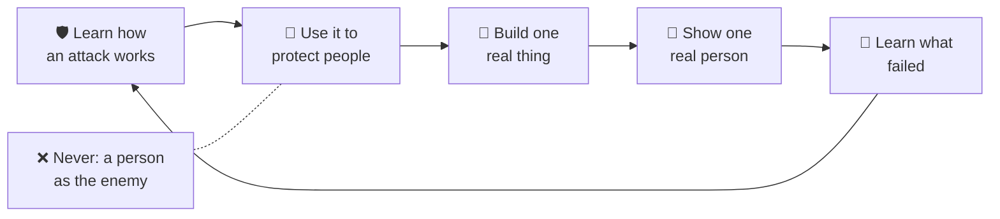

<!-- i18n-source-sha: c21424bb0ef5f5e5 -->
<div align="center">

# 🛡️ Shepherd's Academy of War · 🌱 Daniel &amp; David

**🌐 Read this in:** English · [中文](README.zh.md) · [한국어](README.ko.md) · [日本語](README.ja.md) · [Español](README.es.md) · [Deutsch](README.de.md) · [Français](README.fr.md) &nbsp;<sub>(English is the source of truth; the rest are AI-assisted and may lag)</sub>

### Lerne, wie ein Angriff funktioniert, damit du als Beschützer leben kannst. Werde gemeinsam ein kluger, kreativer, KI-bereiter Erbauer.

**Eine Familienakademie, die auf Autofahrten von einem Vater und seinen zwei Söhnen gegründet wurde. Mut, Können und der Builder Loop (Erbauerschleife), für Erwachsene und Kinder (etwa 5–15 Jahre) Seite an Seite.**

<a href="https://daniel-and-david.vercel.app/">
  
</a>

**[▶️ Spiele das Shepherd's World Model →](https://agentic-portfolio-lovat.vercel.app/play/shepherd.html)** ·
**[Builder Loop App →](https://daniel-and-david.vercel.app/app.html)** ·
**[Lies die SAW-Serie →](https://agentic-portfolio-lovat.vercel.app/articles/saw-academy-of-war-learn-the-attack.html)** ·
**[Bewerben →](https://daniel-and-david.vercel.app/#apply)**

<a href="https://daniel-and-david.vercel.app/">
  
</a>

</div>

> **Ehrlicher Status (2026-10-16).** Shepherd's Academy of War (SAW, Shepherd's Academy of War) ist erst wenige Wochen alt. **Kein Dozent ist bestätigt**, und **nichts davon wurde bisher gemessen**. Der öffentliche Name ist noch auf Probe (siehe [das Signal](#-the-signal-is-this-working)). Was heute läuft: die Builder Loop App, drei kleine Familien-Apps und eine spielbasierte Übung, das Shepherd's World Model.

---

## 📰 Neuigkeiten

- **2026-10-16 · Eine erste Übung zum Spielen: das Shepherd's World Model.** Ein Hirte lernt die geheime Gewohnheit eines Wolfs, um zwei Herden zu schützen. Dies ist das kleinste echte *Weltmodell* in der KI (Stanford CS229 §19.3, Stanford CS229), spielbar von einem 7-Jährigen. 15-Minuten-Skript auf Englisch und 中文: [`docs/saw/drills/shepherd-world-model.md`](docs/saw/drills/shepherd-world-model.md). Essay für Erwachsene: [World Models Start in Six Lines of CS229](https://agentic-portfolio-lovat.vercel.app/articles/world-models-start-in-cs229.html).
- **2026-10-16 · Zahlen in vier Altersstufen.** Eine mathematische Idee („Eine Zahl ist nicht ihr Name“), ehrlich geschrieben für die Altersgruppen 7, 11, 15 und 20, mitverfasst mit Shifeng Chen. Das Stück für 7-Jährige ist ein Theaterskript für Eltern und Kind: [What Is a Number?](https://agentic-portfolio-lovat.vercel.app/articles/number-is-not-its-name.html)
- **2026-10-12 · Die SAW-Serie ist veröffentlicht, bevor etwas gebaut wurde.** Fünf Artikel testen die Idee öffentlich, Name inklusive ([Plan und Scoreboard](docs/saw/SERIES.md)).
- **Früher · Die Builder Loop App, die Apps Gallery und die Founding Families Kohorte** sind live gegangen. Siehe [CHANGELOG.md](CHANGELOG.md).

---

## 🧒 So funktioniert es — ein 10-Jähriger kann folgen (und neu zeichnen)



**In Worten:**
1. Lerne, wie etwas angreift: die Gewohnheit eines Wolfs, ein Betrug, die Taktik eines Mobbers, ein kaputter Plan.
2. Nutze dieses Wissen, um zu schützen.
3. Baue etwas Kleines und Echtes.
4. Zeige es einer echten Person.
5. Lerne aus dem, was gescheitert ist, und beginne die Runde von vorn.

Die eine Regel, die nie gebrochen wird: **Kein Mensch ist jemals der Feind.** Was wir bekämpfen, ist der Angriff, niemals der Mensch.

---

## Was es ist — drei Türen zu einer Akademie

| Tür | Was dort passiert | Wo es lebt |
|---|---|---|
| **1 · Die Akademie (SAW, Shepherd's Academy of War)** | Mut und Können für Kinder: Lerne, wie ein Angriff funktioniert, damit du als Beschützer leben kannst. Fünf Gesetze darüber, worauf dieses Können gerichtet werden darf. Eine Gastdozenten-Regel: **Inhalt, nicht Kontakt**, damit kein Kind jemals allein mit einem Erwachsenen ist. Eine Scorecard, die auch eine Niederlage zeigen kann. | Die [fünfteilige Serie](https://agentic-portfolio-lovat.vercel.app/articles/saw-academy-of-war-learn-the-attack.html) · [`docs/saw/`](docs/saw/) · [Forschung](docs/research/shepherd-warrior-formation.md) |
| **2 · Das Feldlabor (Daniel & David)** | Der **[Builder Loop (Erbauerschleife)](docs/builder-loop/)**: ein vierwöchiges Familienexperiment, durchgeführt als fünf schnelle Bau-Zeige-Lern-Zyklen. KI ist der Teamkollege; du bleibst Verstand und Gewissen. Unternehmungen, Lehrplan, Prinzipien. | [`docs/builder-loop/`](docs/builder-loop/) · [`docs/curriculum/`](docs/curriculum/) · [`ventures/`](ventures/) |
| **3 · Übungen und Demos** | Dinge, die eine Familie in 15–20 Minuten durchführen kann: die wöchentliche **Autofahrt-Übung** (SAW Teil 5) und das **Shepherd's World Model**-Spiel. Dazu kleine Apps (Conversation Spark, Transition Timer, Homework Chunker). | [`docs/saw/drills/`](docs/saw/drills/) · [Apps Gallery](https://daniel-and-david.vercel.app/apps.html) |

---

## ⚡ Schnellstart

**👪 Familien (kein Code, keine Installation):**
1. [Spiele das Shepherd's World Model](https://agentic-portfolio-lovat.vercel.app/play/shepherd.html) mit dem [15-Minuten-Skript](docs/saw/drills/shepherd-world-model.md).
2. Öffne die kostenlose [Builder Loop App](https://daniel-and-david.vercel.app/app.html). Keine Anmeldung nötig, installiert sich auf dem Homescreen und speichert alles auf deinem Gerät.
3. Lies die [Sicherheitsregeln](docs/safety/), bevor du beginnst.

**🛠️ Entwickler und Mitwirkende:**
```bash
git clone https://github.com/wjlgatech/daniel-and-david.git && cd daniel-and-david
./scripts/setup.sh        # macht Skripte ausführbar und führt alle Schutzmechanismen aus
./scripts/check.sh        # die Ziellinie vor jedem PR (die gleichen Schutzmechanismen wie CI)
./scripts/saw-signal.sh   # Funktioniert SAW? Gibt die vier Zahlen und die Zusatz-Zahl aus
```

---

## 🧭 Was du hier tun kannst

| Du möchtest… | Gehe hierhin |
|---|---|
| Heute Abend eine 15-Minuten-Familienübung durchführen | [Shepherd's World Model Skript](docs/saw/drills/shepherd-world-model.md) (EN + 中文) → [das Spiel](https://agentic-portfolio-lovat.vercel.app/play/shepherd.html) |
| Die wöchentliche Autofahrt-Übung machen | [SAW Teil 5: eine Übung, vier Zahlen, sechs Stolperdrähte](https://agentic-portfolio-lovat.vercel.app/articles/saw-scorecard-drill-numbers-tripwires.html) |
| Ein vierwöchiges Familienprojekt starten | [Der Builder Loop](docs/builder-loop/) → [die App](https://daniel-and-david.vercel.app/app.html) · [druckbar](docs/builder-loop/printable.md) |
| Prüfen, ob SAW funktioniert | `./scripts/saw-signal.sh` · das Kassenbuch [`docs/saw/signal.json`](docs/saw/signal.json) |
| Verstehen, warum das Wort „Krieg“ bleibt (vorerst) | [SAW Teil 1](https://agentic-portfolio-lovat.vercel.app/articles/saw-academy-of-war-learn-the-attack.html) |
| Einen Gast-Experten sicher einladen | [SAW Teil 4: Inhalt, nicht Kontakt](https://agentic-portfolio-lovat.vercel.app/articles/saw-guest-instructors-content-not-contact.html) |
| Als Gründungsfamilie mitmachen | [Founding Families](docs/founding-families.md) (⛏️ Genesis · 8 Plätze) |
| Mitwirken | [CONTRIBUTING.md](CONTRIBUTING.md) · [AGENTS.md](AGENTS.md) |

---

## 📚 Die Texte

Längere Stücke findest du im [agentic portfolio](https://agentic-portfolio-lovat.vercel.app/#writing) des Autors. Jedes ist in fünf Sprachen verfügbar (Englisch, 中文, Spanisch, Koreanisch, Japanisch).

| Stück | Für wen | Link |
|---|---|---|
| SAW 1 · An Academy of War for Children: Learn the Attack, Live as a Protector | Eltern, Führungskräfte | [lesen](https://agentic-portfolio-lovat.vercel.app/articles/saw-academy-of-war-learn-the-attack.html) |
| SAW 2 · Revelation 19 Has One Fighter, and the Long War Has Five Arenas | Eltern | [lesen](https://agentic-portfolio-lovat.vercel.app/articles/saw-revelation-19-one-fighter.html) |
| SAW 3 · Courage Training for Children: What the Evidence Supports and What Backfires | Eltern | [lesen](https://agentic-portfolio-lovat.vercel.app/articles/saw-courage-training-evidence.html) |
| SAW 4 · Guest Instructors for Children: Content, Not Contact | Eltern, Gäste | [lesen](https://agentic-portfolio-lovat.vercel.app/articles/saw-guest-instructors-content-not-contact.html) |
| SAW 5 · A Scorecard for a Family Academy: One Car-Ride Drill, Four Numbers, Six Tripwires | Eltern, Führungskräfte | [lesen](https://agentic-portfolio-lovat.vercel.app/articles/saw-scorecard-drill-numbers-tripwires.html) |
| World Models Start in Six Lines of CS229 (and the Shepherd's World Model) | Ingenieure; die Übung ist für 7–11 Jahre | [lesen](https://agentic-portfolio-lovat.vercel.app/articles/world-models-start-in-cs229.html) · [spielen](https://agentic-portfolio-lovat.vercel.app/play/shepherd.html) |
| What Is a Number? (Numbers at Four Ages, age 7) | ein Kind + ein Erwachsener | [lesen](https://agentic-portfolio-lovat.vercel.app/articles/number-is-not-its-name.html) |
| Number Systems (age 11) · Place Value (age 15) · Number vs Representation (age 20) | 11, 15, 20 Jahre | [11](https://agentic-portfolio-lovat.vercel.app/articles/number-systems-from-tally-to-place-value.html) · [15](https://agentic-portfolio-lovat.vercel.app/articles/place-value-ten-symbols-every-number.html) · [20](https://agentic-portfolio-lovat.vercel.app/articles/number-vs-representation-for-programmers.html) · [spielen](https://agentic-portfolio-lovat.vercel.app/play/numbers.html) |

---

## 🎯 Festgelegte Entscheidungen (und warum)

- **Kein Mensch ist jemals der Feind.** Das Können richtet sich gegen Angriffe, nie gegen Menschen. Gewaltvolle Sprache über Menschen besteht die eigene Prüfung der Serie nicht.
- **Inhalt, nicht Kontakt.** Ein Gast-Experte unterrichtet durch aufgezeichnete oder beaufsichtigte Inhalte, sodass kein Kind jemals allein mit einem Erwachsenen ist. Sicherheitsregeln: [`docs/safety/`](docs/safety/).
- **Nichts wird behauptet, was nicht gemessen ist.** Die Serie sagt „nichts ist bisher gemessen“, bis das Kassenbuch etwas anderes zeigt, und kein Dozent wird genannt, solange `faculty_confirmed` 0 ist.
- **Signal vor Bau.** Es gibt keinen SAW-Bau, bevor die vier Zahlen bestehen ([das Signal](#-the-signal-is-this-working)). Das Shepherd's World Model ist eine Portfolio-Demo, die SAW ausleiht, nicht der SAW-Bau.
- **Fähigkeit, nicht Geld.** Wir messen, was ein Kind ohne Druck tun kann ([Theory of Change](docs/vision/theory-of-change.md)), auf der untenstehenden Fähigkeitsleiter.

---

## 📏 Das Signal: Funktioniert das?

Die SAW-Serie wurde geschrieben, um eine Entscheidung zu ermöglichen, nicht um Applaus zu bekommen. Bis **2026-11-11** muss [`signal.json`](docs/saw/signal.json) diese Zahlen enthalten. `./scripts/saw-signal.sh` gibt sie aus und beendet sich mit 1, wenn nach dem Datum noch eine fehlt.

| Zahl | Bestanden | Was sie entscheidet |
|---|---|---|
| `strangers_asked`, `strangers_heard_militant` | 20+ gefragt, weniger als die Hälfte hören „militant“ | Ob der öffentliche Name bleibt, einschließlich des Reponamens |
| `reader_mission_numbers` | 10+ Missions-Ergebnisse von Lesern gepostet | Ob es außer uns jemand durchführt |
| `outside_reviewers_of_guest_rules` | 1+ Kinderschutz-Prüfer für Teil 4 | Ob ein erster Gast eingeladen werden darf |
| `family_drills_run` | 4+ wöchentliche Autofahrt-Übungen, mit den eigenen Karten der Kinder | Ob die Übung einen Siebenjährigen übersteht |
| *zusätzlich:* `shepherd_demo_drills` | gezählt, nicht begrenzend | Wie viele Familien das Shepherd's World Model durchgeführt haben (zählt nie zu den vier) |

**Heute:** 0 von 4 gemessen. Das ist ehrlich für Woche drei, und es wird laut, wenn es am 2026-11-11 noch so ist.

---

## 🏷️ Zum Namen (und dem Namen dieses Repositories)

Das Repository heißt absichtlich noch `daniel-and-david`. SAWs eigene Regel stellt den öffentlichen Namen bis **2026-11-11** auf Probe: Wenn weniger als die Hälfte von 20 Fremden „militant“ hören, bleibt der Name öffentlich. Das Repository vorher umzubenennen, würde diesen Test entscheiden, bevor es Daten gibt.

Wenn der Name besteht, ist die Umbenennung ein Befehl:
```bash
gh repo rename shepherds-academy-of-war --repo wjlgatech/daniel-and-david
```
GitHub leitet die alte Repository-URL und git remotes um, und die Live-Seite unter daniel-and-david.vercel.app bleibt unverändert. **Eine Sache bricht:** Die GitHub Pages-Adresse (`wjlgatech.github.io/daniel-and-david/`) würde sich ändern. Daher muss die Umbenennung alle Pages-Links in diesem README und in `apps/web` im selben Schritt aktualisieren.

Wenn der Name nicht besteht, bleibt SAW der private Name der Familie und dieses Repository behält den Feldlabor-Namen.

---

## Die Leiter, die wir wirklich erklimmen

Wir messen **Fähigkeit**, nicht Geld. Die öffentliche Leiter ist das, was jeder, Kind *oder* Erwachsener, *tun* kann:

<p align="center"></p>

*Das Spiel ist, wer du wirst, während du kletterst.* Es gibt auch eine fortgeschrittene Venture-Stufe. Sie ist absichtlich weiter unten angesiedelt. Siehe [die Leitern](docs/vision/milestones.md).

---

## Wie ein Erbauer entsteht

Nicht durch einen Vortrag. Sondern durch **den Bau einer echten Sache, von Anfang bis Ende, und das Lernen aus jedem Teil, warum es funktioniert hat oder nicht.**

<p align="center"></p>

- **Die Unternehmungen.** [`ventures/kc-matchday-basecamp/`](ventures/kc-matchday-basecamp/) ist ein legales, mit Veranstaltern kooperierendes Fan-Utility- und Lokalhandelskonzept für Kansas Citys Fußballsommer. **Spec ✅ fertig; Web-App 🟡 Bau noch nicht begonnen.**
- **Der Lehrplan.** Eine Methode, jedes Alter:
  - [Daniel, 11 Jahre](docs/curriculum/daniel-age-11/): baut, kalkuliert Preise, verkauft und misst, und leitet ein [AI Build Kit](docs/curriculum/daniel-age-11/build-kit.md);
  - [David, 6 Jahre](docs/curriculum/david-age-6/): zählt, zeichnet die Zeichen, begrüßt den Kunden;
  - [Kritisches Denken](docs/curriculum/critical-thinking/): das 5W1H-Raster, auch [in unsere KI-Teamkollegen eingebaut](.claude/README.md).
- **Die Prinzipien:**
  - [AI-Native Company](docs/principles/ai-native-company.md)
  - [Agentic Engineering](docs/principles/agentic-engineering.md)
  - [Pain2Gain](docs/principles/pain2gain.md)
  - [Werte](docs/principles/values.md)

<p align="center"></p>

### In Planung, noch nicht ausgeliefert

- 🗣️ **Der Builder Loop Coach.** Ein sprachbasierter Coach führt die gleiche Schleife per Sprache durch. Deine Daten bleiben auf dem Gerät und es ist immer klar, dass es eine KI ist. Siehe [`apps/web-agent/`](apps/web-agent/).
- 🌿 **Die Isaiah 35 Restoration Track** ist für Erwachsene in einer dürreartigen Lebensphase. Sie nutzt vier Prinzipien (Restoration, Redemption, Regeneration, Resurrection) durch die gleiche Schleife. Sie ist glaubensbasiert, aber jeder ist willkommen. Siehe [den Track](docs/vision/isaiah-35-restoration.md) und die [4-wöchige Restoration Loop](docs/curriculum/adult-restoration/).
- 🌍 **Ein Hub.** Ein lebendiger Lern-Hub, ein Werkzeug-Hub und ein Kollaborations-Hub, offen für Eltern, Kinder, Ingenieure, Gründer und KI-Agenten. Siehe den [Hub-Guide](docs/community/hub.md).

---

## 🗺️ Repository-Übersicht

```
daniel-and-david/                 (die Heimat von Shepherd's Academy of War; Namensentscheidung am 2026-11-11)
├── docs/
│   ├── saw/             🛡️ SAW: Serienplan, Signal-Kassenbuch und drills/ (das Shepherd's World Model Skript, EN + 中文)
│   ├── builder-loop/    ⭐ Der 4-wöchige Familien-Builder Loop, die atomare Einheit des Feldlabors
│   ├── founding-families.md  🧱 The Halving: Bewerbung für die Gründungskohorte
│   ├── vision/          Mission, Theory of Change + Nordstern, die zwei Leitern, der Restoration Track
│   ├── safety/          Kindersicherheit, Datenschutz, Einwilligung, Moderation, KI-Nutzungsgrenzen
│   ├── research/        Zitierte Forschung, inkl. shepherd-warrior-formation Dossier hinter SAW
│   ├── principles/      Wie wir arbeiten: AI-native, agentisches Engineering, Werte
│   ├── curriculum/      Daniel (11), David (6), kritisches Denken, Erwachsenen-Restoration
│   ├── marketing/       Die Langform-Story und fertige LinkedIn-Posts
│   ├── community/       Der Hub-Guide
│   └── assets/          Infografiken (SVG) für dieses README
├── apps/web/            Die Live-Seite (daniel-and-david.vercel.app): Landingpage, Builder Loop App, Demos
├── apps/web-agent/      🟡 Builder Loop Coach (Spezifikation in Planung)
├── ventures/            Venture #1: kc-matchday-basecamp
├── agents/hello-agent/  Ein kleiner Starter-Agent
├── scripts/             setup.sh · check.sh (Schutzmechanismen) · saw-signal.sh (das SAW-Urteil)
├── .claude/             Agenten-Toolkit: Skills, Workflows, Hooks
└── .github/             CI, Templates, Contributor-Onramp
```

---

## 🛠️ Entwicklung

```bash
./scripts/check.sh   # alle Schutzmechanismen: Links · Toolkit · Status-Wahrheit · Registrierungs-Sicherheit · Webapp (wie CI)
```

Grün bedeutet: Jeder Link funktioniert, jede Statusaussage in den Docs ist wahr, das Registrierungsformular ist sicher und die Web-App funktioniert. Agenten: Lies zuerst [AGENTS.md](AGENTS.md) und [.claude/README.md](.claude/README.md). Unser kurzfristiges Ziel ist **zehn Familien, die einen echten Builder Loop abschließen**, und die vier SAW-Zahlen am Stichtag.

> 🧱 **Gründungsfamilien** erhalten privaten Frühzugang zum eigenen KI-Workshop des Studios (AnyAgent, Super U, DreamMakeTrue). Siehe [Founding Families](docs/founding-families.md).

---

## 📖 Dokumentation

| Doku | Inhalt |
|---|---|
| [`docs/saw/SERIES.md`](docs/saw/SERIES.md) | Der SAW-Plan, sein 10X so definiert, dass er scheitern kann, und die Entscheidungen, die nur der Gründer trifft |
| [`docs/saw/drills/shepherd-world-model.md`](docs/saw/drills/shepherd-world-model.md) | Das 15-Minuten-Shepherd's World Model-Übungsskript, auf Englisch und 中文 |
| [`docs/research/shepherd-warrior-formation.md`](docs/research/shepherd-warrior-formation.md) | Das Forschungsdossier hinter SAW |
| [`docs/builder-loop/`](docs/builder-loop/) | Der Builder Loop Guide, druckbar und Iterationsprotokoll |
| [`docs/safety/`](docs/safety/) | Kindersicherheits-, Datenschutz- und Einwilligungsregeln (vor jeder Aktivität lesen) |
| [`docs/vision/theory-of-change.md`](docs/vision/theory-of-change.md) | Das Wirkmodell und die eine Metrik, die wir verfolgen |
| [`docs/founding-families.md`](docs/founding-families.md) | Die Gründungskohorte und der Halving-Zeitplan |
| [`docs/marketing/the-daniel-and-david-story.md`](docs/marketing/the-daniel-and-david-story.md) | Die Geschichte, einfach genug für einen 10-Jährigen, belegt genug für einen Skeptiker |

---

## Der Standard, den wir halten

<p align="center"></p>

- **Immer legal und ehrlich.** Wir gewinnen durch Vertrauenswürdigkeit, nicht durch Abkürzungen.
- **Klein liefern, echt liefern.** Etwas Funktionierendes schlägt einen perfekten Plan.
- **Lehre beim Bauen.** Wenn ein 6-Jähriger das *Warum* nicht versteht, erklären wir es besser.
- **Geben beim Wachsen.** Großzügigkeit ist im Modell eingebaut, nicht später angehängt.

---

## Lizenz

[MIT](LICENSE). Offen entwickelt, frei zum Lernen, frei zum Weiterbauen.

<p align="center"><i>Lerne den Angriff, lebe als Beschützer. Baue etwas Gutes. Nutze es, um zu segnen. — für Daniel &amp; David</i></p>
