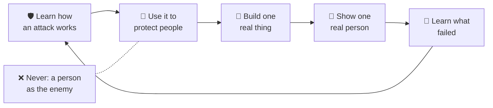

<!-- i18n-source-sha: c21424bb0ef5f5e5 -->
<div align="center">

# 🛡️ Shepherd's Academy of War · 🌱 Daniel &amp; David

**🌐 Read this in:** English · [中文](README.zh.md) · [한국어](README.ko.md) · [日本語](README.ja.md) · [Español](README.es.md) · [Deutsch](README.de.md) · [Français](README.fr.md) &nbsp;<sub>(English is the source of truth; the rest are AI-assisted and may lag)</sub>

### Aprende cómo funciona un ataque, para que puedas vivir como protector. Conviértete en un constructor sabio, creativo y preparado para la IA, juntos.

**Una academia familiar iniciada en viajes en coche por un padre y sus dos hijos. Valentía, habilidad y el Builder Loop (Bucle del Constructor), para adultos y niños (aproximadamente de 5 a 15 años) lado a lado.**

<a href="https://daniel-and-david.vercel.app/">
  
</a>

**[▶️ Juega el Shepherd's World Model (Modelo del Mundo del Pastor) →](https://agentic-portfolio-lovat.vercel.app/play/shepherd.html)** ·
**[App Builder Loop →](https://daniel-and-david.vercel.app/app.html)** ·
**[Lee la serie SAW →](https://agentic-portfolio-lovat.vercel.app/articles/saw-academy-of-war-learn-the-attack.html)** ·
**[Aplica →](https://daniel-and-david.vercel.app/#apply)**

<a href="https://daniel-and-david.vercel.app/">
  
</a>

</div>

> **Estado honesto (2026-10-16).** Shepherd's Academy of War (SAW, Academia de Guerra del Pastor) tiene pocas semanas de existencia. **Ningún instructor está confirmado**, y **nada ha sido medido aún**. Su nombre público sigue a prueba (ver [la señal](#-the-signal-is-this-working)). Lo que funciona hoy: la app Builder Loop, tres pequeñas apps familiares y un ejercicio basado en juego, el Shepherd's World Model (Modelo del Mundo del Pastor).

---

## 📰 Noticias

- **2026-10-16 · Un primer ejercicio que puedes jugar: Shepherd's World Model (Modelo del Mundo del Pastor).** Un pastor aprende el hábito secreto de un lobo para proteger dos rebaños. Este es el *modelo del mundo* más pequeño y real en IA (Stanford CS229 §19.3), jugable por un niño de 7 años. Guion de 15 minutos en inglés y 中文: [`docs/saw/drills/shepherd-world-model.md`](docs/saw/drills/shepherd-world-model.md). Ensayo para adultos: [World Models Start in Six Lines of CS229](https://agentic-portfolio-lovat.vercel.app/articles/world-models-start-in-cs229.html).
- **2026-10-16 · Números a Cuatro Edades.** Una idea matemática ("un número no es su nombre"), escrita honestamente para edades 7, 11, 15 y 20, coautoría con Shifeng Chen. La pieza para 7 años es un guion para padre e hijo: [¿Qué es un número?](https://agentic-portfolio-lovat.vercel.app/articles/number-is-not-its-name.html)
- **2026-10-12 · Se publica la serie SAW, antes de construir nada.** Cinco artículos ponen la idea a prueba en público, nombre incluido ([plan y marcador](docs/saw/SERIES.md)).
- **Anteriormente · La app Builder Loop, la Galería de Apps y la cohorte de Familias Fundadoras** se lanzaron. Ver [CHANGELOG.md](CHANGELOG.md).

---

## 🧒 Cómo funciona — un niño de 10 años puede seguir (y volver a dibujar) esto



**En palabras:**
1. Aprende cómo algo ataca: el hábito de un lobo, una estafa, el movimiento de un abusón, un plan roto.
2. Usa ese conocimiento para proteger.
3. Construye algo pequeño y real.
4. Muéstralo a una persona real.
5. Aprende de lo que falló, y vuelve a empezar.

La única regla que nunca se dobla: **ninguna persona es jamás el enemigo.** Lo que combatimos es el ataque, nunca al ser humano.

---

## Qué es — tres puertas a una sola academia

| Puerta | Qué sucede ahí | Dónde vive |
|---|---|---|
| **1 · La Academia (SAW)** | Valentía y habilidad para niños: aprende cómo funciona un ataque, para que puedas vivir como protector. Cinco leyes sobre dónde puede dirigirse esa habilidad. Una regla para instructores invitados: **contenido, no contacto**, así ningún niño está nunca a solas con un adulto. Un marcador que puede mostrar una derrota. | La [serie de cinco partes](https://agentic-portfolio-lovat.vercel.app/articles/saw-academy-of-war-learn-the-attack.html) · [`docs/saw/`](docs/saw/) · [investigación](docs/research/shepherd-warrior-formation.md) |
| **2 · El Laboratorio de Campo (Daniel & David)** | El **[Builder Loop (Bucle del Constructor)](docs/builder-loop/)**: un experimento familiar de cuatro semanas realizado como cinco ciclos rápidos de construir-mostrar-aprender. La IA es el compañero de equipo; tú sigues siendo la mente y la conciencia. Proyectos, currículo, principios. | [`docs/builder-loop/`](docs/builder-loop/) · [`docs/curriculum/`](docs/curriculum/) · [`ventures/`](ventures/) |
| **3 · Ejercicios y demostraciones** | Cosas que una familia puede hacer en 15–20 minutos: el **ejercicio semanal en el coche** (SAW parte 5) y el juego **Shepherd's World Model**. Además, pequeñas apps (Conversation Spark, Transition Timer, Homework Chunker). | [`docs/saw/drills/`](docs/saw/drills/) · [Galería de Apps](https://daniel-and-david.vercel.app/apps.html) |

---

## ⚡ Comienza rápido

**👪 Familias (sin código, sin instalación):**
1. [Juega el Shepherd's World Model](https://agentic-portfolio-lovat.vercel.app/play/shepherd.html) con el [guion de 15 minutos](docs/saw/drills/shepherd-world-model.md).
2. Abre la [app Builder Loop](https://daniel-and-david.vercel.app/app.html) gratis. No requiere registro, se instala en tu pantalla de inicio y guarda todo en tu dispositivo.
3. Lee las [reglas de seguridad](docs/safety/) antes de empezar.

**🛠️ Desarrolladores y colaboradores:**
```bash
git clone https://github.com/wjlgatech/daniel-and-david.git && cd daniel-and-david
./scripts/setup.sh        # hace ejecutables los scripts y ejecuta todos los guardarraíles
./scripts/check.sh        # la meta antes de cualquier PR (los mismos guardarraíles que CI ejecuta)
./scripts/saw-signal.sh   # ¿está funcionando SAW? imprime los cuatro números, más el suplementario
```

---

## 🧭 Qué puedes hacer aquí

| Quieres… | Ve aquí |
|---|---|
| Hacer un ejercicio familiar de 15 minutos esta noche | [Guion Shepherd's World Model](docs/saw/drills/shepherd-world-model.md) (EN + 中文) → [el juego](https://agentic-portfolio-lovat.vercel.app/play/shepherd.html) |
| Hacer el ejercicio semanal en el coche | [SAW parte 5: un ejercicio, cuatro números, seis alarmas](https://agentic-portfolio-lovat.vercel.app/articles/saw-scorecard-drill-numbers-tripwires.html) |
| Empezar un proyecto familiar de cuatro semanas | [El Builder Loop](docs/builder-loop/) → [la app](https://daniel-and-david.vercel.app/app.html) · [imprimible](docs/builder-loop/printable.md) |
| Ver si SAW está funcionando | `./scripts/saw-signal.sh` · el registro [`docs/saw/signal.json`](docs/saw/signal.json) |
| Entender por qué la palabra "guerra" se mantiene (por ahora) | [SAW parte 1](https://agentic-portfolio-lovat.vercel.app/articles/saw-academy-of-war-learn-the-attack.html) |
| Invitar a un experto invitado de forma segura | [SAW parte 4: contenido, no contacto](https://agentic-portfolio-lovat.vercel.app/articles/saw-guest-instructors-content-not-contact.html) |
| Unirte como familia fundadora | [Familias Fundadoras](docs/founding-families.md) (⛏️ Génesis · 8 lugares) |
| Contribuir | [CONTRIBUTING.md](CONTRIBUTING.md) · [AGENTS.md](AGENTS.md) |

---

## 📚 Los escritos

Los textos largos viven en el [portafolio agentic del autor](https://agentic-portfolio-lovat.vercel.app/#writing). Cada uno está en cinco idiomas (English, 中文, Español, 한국어, 日本語).

| Pieza | Para | Enlace |
|---|---|---|
| SAW 1 · Una Academia de Guerra para Niños: Aprende el Ataque, Vive como Protector | padres, líderes | [leer](https://agentic-portfolio-lovat.vercel.app/articles/saw-academy-of-war-learn-the-attack.html) |
| SAW 2 · Apocalipsis 19 Tiene Un Luchador, y la Larga Guerra Tiene Cinco Arenas | padres | [leer](https://agentic-portfolio-lovat.vercel.app/articles/saw-revelation-19-one-fighter.html) |
| SAW 3 · Entrenamiento de Valentía para Niños: Lo que Apoya la Evidencia y lo que Sale Mal | padres | [leer](https://agentic-portfolio-lovat.vercel.app/articles/saw-courage-training-evidence.html) |
| SAW 4 · Instructores Invitados para Niños: Contenido, No Contacto | padres, invitados | [leer](https://agentic-portfolio-lovat.vercel.app/articles/saw-guest-instructors-content-not-contact.html) |
| SAW 5 · Un Marcador para una Academia Familiar: Un Ejercicio en el Coche, Cuatro Números, Seis Alarmas | padres, líderes | [leer](https://agentic-portfolio-lovat.vercel.app/articles/saw-scorecard-drill-numbers-tripwires.html) |
| World Models Start in Six Lines of CS229 (y el Shepherd's World Model) | ingenieros; el ejercicio es para edades 7–11 | [leer](https://agentic-portfolio-lovat.vercel.app/articles/world-models-start-in-cs229.html) · [jugar](https://agentic-portfolio-lovat.vercel.app/play/shepherd.html) |
| ¿Qué es un número? (Números a Cuatro Edades, edad 7) | un niño + un adulto | [leer](https://agentic-portfolio-lovat.vercel.app/articles/number-is-not-its-name.html) |
| Sistemas Numéricos (edad 11) · Valor Posicional (edad 15) · Número vs Representación (edad 20) | edades 11, 15, 20 | [11](https://agentic-portfolio-lovat.vercel.app/articles/number-systems-from-tally-to-place-value.html) · [15](https://agentic-portfolio-lovat.vercel.app/articles/place-value-ten-symbols-every-number.html) · [20](https://agentic-portfolio-lovat.vercel.app/articles/number-vs-representation-for-programmers.html) · [jugar](https://agentic-portfolio-lovat.vercel.app/play/numbers.html) |

---

## 🎯 Decisiones tomadas (y por qué)

- **Ninguna persona es jamás el enemigo.** La habilidad se dirige a los ataques, nunca a las personas. El lenguaje violento sobre personas no pasa la propia puerta de la serie.
- **Contenido, no contacto.** Un experto invitado enseña mediante contenido grabado o supervisado, así ningún niño está nunca a solas con un adulto. Reglas de seguridad: [`docs/safety/`](docs/safety/).
- **Nada se afirma que no se mida.** La serie dice "nada ha sido medido aún" hasta que el registro diga lo contrario, y no se afirma que hay instructor mientras `faculty_confirmed` sea 0.
- **Señal antes de construir.** No hay construcción de SAW hasta que sus cuatro números pasen ([la señal](#-the-signal-is-this-working)). El Shepherd's World Model es una demo de portafolio que SAW toma prestada, no la construcción de SAW.
- **Capacidad, no dinero.** Medimos lo que un niño puede hacer sin ser empujado ([Teoría del Cambio](docs/vision/theory-of-change.md)), en la Escalera de Capacidades de abajo.

---

## 📏 La señal: ¿está funcionando?

La serie SAW fue escrita para producir una decisión, no aplausos. Para el **2026-11-11**, [`signal.json`](docs/saw/signal.json) debe contener estos números. `./scripts/saw-signal.sh` los imprime y sale con 1 si falta alguno después de la fecha.

| Número | Pasa | Qué decide |
|---|---|---|
| `strangers_asked`, `strangers_heard_militant` | 20+ preguntados, menos de la mitad oyen "militante" | Si el nombre público se mantiene, incluido el nombre de este repositorio |
| `reader_mission_numbers` | 10+ resultados de misión publicados por lectores | Si alguien más que nosotros lo ejecuta |
| `outside_reviewers_of_guest_rules` | 1+ revisor de protección infantil de la parte 4 | Si se puede invitar a un primer invitado |
| `family_drills_run` | 4+ ejercicios semanales en el coche, con las propias tarjetas de los niños | Si el ejercicio sobrevive a un niño de siete años |
| *suplementario:* `shepherd_demo_drills` | contado, no limita | Cuántas familias hicieron el Shepherd's World Model (nunca cuenta para los cuatro) |

**Hoy:** 0 de 4 medidos. Eso es honesto para la semana tres, y será notorio si sigue siendo cierto el 2026-11-11.

---

## 🏷️ Sobre el nombre (y el nombre de este repositorio)

El repositorio sigue llamándose `daniel-and-david`, a propósito. La propia regla de SAW pone su nombre público a prueba hasta el **2026-11-11**: si menos de la mitad de 20 desconocidos oyen "militante", el nombre se mantiene público. Cambiar el nombre del repositorio antes decidiría esa prueba antes de que existan los datos.

Si el nombre pasa, el cambio es un solo comando:
```bash
gh repo rename shepherds-academy-of-war --repo wjlgatech/daniel-and-david
```
GitHub redirige la URL antigua del repositorio y los remotos de git, y el sitio en vivo en daniel-and-david.vercel.app no se ve afectado. **Una cosa se rompe:** la dirección de GitHub Pages (`wjlgatech.github.io/daniel-and-david/`) se movería. Así que el cambio de nombre debe actualizar cada enlace de Pages en este README y en `apps/web` en el mismo cambio.

Si el nombre falla, SAW sigue siendo el nombre privado de la familia, y este repositorio mantiene el nombre del laboratorio de campo.

---

## La escalera que realmente subimos

Medimos **capacidad**, no dinero. La escalera pública es lo que cualquiera, niño *o* adulto, puede *hacer*:

<p align="center"></p>

*El juego es en quién te conviertes mientras subes.* También hay una vía avanzada de emprendimiento. Vive más abajo, a propósito. Ver [las escaleras](docs/vision/milestones.md).

---

## Cómo se forma un constructor

No por una clase magistral. Por **construir algo real, de principio a fin, y aprender cada parte de por qué funcionó o no.**

<p align="center"></p>

- **Los proyectos.** [`ventures/kc-matchday-basecamp/`](ventures/kc-matchday-basecamp/) es un concepto legal, con socios de sede, para utilidad de fans y comercio local en el verano de fútbol de Kansas City. **Especificación ✅ completa; app web 🟡 construcción no iniciada.**
- **El currículo.** Un método, todas las edades:
  - [Daniel, 11 años](docs/curriculum/daniel-age-11/): construye, pone precio, vende y mide, y lidera un [AI Build Kit](docs/curriculum/daniel-age-11/build-kit.md);
  - [David, 6 años](docs/curriculum/david-age-6/): cuenta, dibuja los signos, saluda al cliente;
  - [Pensamiento Crítico](docs/curriculum/critical-thinking/): la cuadrícula 5W1H, también [integrada en nuestros compañeros IA](.claude/README.md).
- **Los principios:**
  - [AI-Native Company](docs/principles/ai-native-company.md)
  - [Agentic Engineering](docs/principles/agentic-engineering.md)
  - [Pain2Gain](docs/principles/pain2gain.md)
  - [Valores](docs/principles/values.md)

<p align="center"></p>

### En diseño, no lanzado

- 🗣️ **El Coach del Builder Loop.** Un coach por voz ejecuta el mismo bucle conversando. Tus datos permanecen en el dispositivo, y siempre queda claro que es una IA. Ver [`apps/web-agent/`](apps/web-agent/).
- 🌿 **La Vía de Restauración de Isaías 35** es para adultos en una temporada árida. Usa cuatro principios (Restauración, Redención, Regeneración, Resurrección) a través del mismo bucle. Tiene raíz de fe y todos son bienvenidos. Ver [la vía](docs/vision/isaiah-35-restoration.md) y el [Bucle de Restauración de 4 semanas](docs/curriculum/adult-restoration/).
- 🌍 **Un hub.** Un hub vivo de aprendizaje, herramientas y colaboración, abierto a padres, niños, ingenieros, fundadores y agentes IA. Ver la [Guía del Hub](docs/community/hub.md).

---

## 🗺️ Mapa del repositorio

```
daniel-and-david/                 (el hogar de Shepherd's Academy of War; decisión de nombre el 2026-11-11)
├── docs/
│   ├── saw/             🛡️ SAW: plan de la serie, registro de señales y drills/ (el guion del Shepherd's World Model, EN + 中文)
│   ├── builder-loop/    ⭐ El Builder Loop familiar de 4 semanas, la unidad atómica del laboratorio de campo
│   ├── founding-families.md  🧱 El Halving: aplica a la cohorte fundadora
│   ├── vision/          Misión, Teoría del Cambio + Estrella Polar, las dos escaleras, la Vía de Restauración
│   ├── safety/          Seguridad infantil, privacidad, consentimiento, moderación, límites de uso de IA
│   ├── research/        Investigación citada, incluido el dossier de formación pastor-guerrero detrás de SAW
│   ├── principles/      Cómo trabajamos: empresa nativa de IA, ingeniería agentica, valores
│   ├── curriculum/      Daniel (11), David (6), pensamiento crítico, restauración adulta
│   ├── marketing/       La historia larga y posts listos para LinkedIn
│   ├── community/       Guía del Hub
│   └── assets/          Infografías (SVG) usadas en este README
├── apps/web/            El sitio en vivo (daniel-and-david.vercel.app): landing, app Builder Loop, demos
├── apps/web-agent/      🟡 Builder Loop Coach (especificación en diseño)
├── ventures/            Proyecto #1: kc-matchday-basecamp
├── agents/hello-agent/  Un agente inicial pequeño
├── scripts/             setup.sh · check.sh (guardarraíles) · saw-signal.sh (el veredicto de SAW)
├── .claude/             Kit de herramientas de agentes: habilidades, flujos de trabajo, hooks
└── .github/             CI, plantillas, onboarding de colaboradores
```

---

## 🛠️ Desarrollo

```bash
./scripts/check.sh   # todos los guardarraíles: enlaces · toolkit · status-truth · registration-safety · webapp (igual que CI)
```

Verde significa que cada enlace resuelve, cada afirmación de estado en los docs es verdadera, el formulario de registro es seguro y la app web funciona. Agentes: lee [AGENTS.md](AGENTS.md) y [.claude/README.md](.claude/README.md) primero. Nuestra meta a corto plazo no es el volumen de contribuciones. Es **diez familias completando un Builder Loop real**, y los cuatro números de SAW en la fecha.

> 🧱 **Familias fundadoras** obtienen acceso privado temprano al propio taller de IA del estudio (AnyAgent, Super U, DreamMakeTrue). Ver [Familias Fundadoras](docs/founding-families.md).

---

## 📖 Documentos

| Doc | Qué contiene |
|---|---|
| [`docs/saw/SERIES.md`](docs/saw/SERIES.md) | El plan de SAW, su 10X definido para que pueda fallar, y las decisiones que solo el fundador toma |
| [`docs/saw/drills/shepherd-world-model.md`](docs/saw/drills/shepherd-world-model.md) | El guion del ejercicio Shepherd's World Model de 15 minutos, en inglés y 中文 |
| [`docs/research/shepherd-warrior-formation.md`](docs/research/shepherd-warrior-formation.md) | El dossier de investigación detrás de SAW |
| [`docs/builder-loop/`](docs/builder-loop/) | Guía del Builder Loop, imprimible y registro de iteraciones |
| [`docs/safety/`](docs/safety/) | Reglas de seguridad infantil, privacidad y consentimiento (leer antes de cualquier actividad) |
| [`docs/vision/theory-of-change.md`](docs/vision/theory-of-change.md) | El modelo causal y la única métrica que seguimos |
| [`docs/founding-families.md`](docs/founding-families.md) | La cohorte fundadora y el calendario de halving |
| [`docs/marketing/the-daniel-and-david-story.md`](docs/marketing/the-daniel-and-david-story.md) | La historia, simple para un niño de 10 años, con citas para un escéptico |

---

## El estándar que mantenemos

<p align="center"></p>

- **Legal y honesto, siempre.** Ganamos siendo confiables, no haciendo trampas.
- **Entrega pequeño, entrega real.** Algo que funciona supera a un plan perfecto.
- **Enseña mientras construyes.** Si un niño de 6 años no puede captar el *por qué*, explicamos mejor.
- **Da mientras creces.** La generosidad está integrada en el modelo, no añadida después.

---

## Licencia

[MIT](LICENSE). Construido en abierto, libre para aprender, libre para construir sobre ello.

<p align="center"><i>Aprende el ataque, vive como protector. Construye algo bueno. Úsalo para bendecir. — para Daniel &amp; David</i></p>
