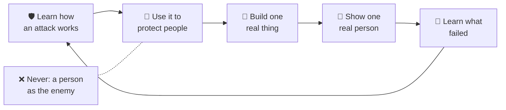

<!-- i18n-source-sha: c21424bb0ef5f5e5 -->
<div align="center">

# 🛡️ Shepherd's Academy of War · 🌱 Daniel &amp; David

**🌐 Read this in:** English · [中文](README.zh.md) · [한국어](README.ko.md) · [日本語](README.ja.md) · [Español](README.es.md) · [Deutsch](README.de.md) · [Français](README.fr.md) &nbsp;<sub>(English is the source of truth; the rest are AI-assisted and may lag)</sub>

### Apprenez comment fonctionne une attaque, pour pouvoir vivre en protecteur. Devenez un bâtisseur sage, créatif et prêt pour l’IA, ensemble.

**Une académie familiale née lors de trajets en voiture par un père et ses deux fils. Courage, compétence et le Builder Loop (Boucle du Bâtisseur), pour adultes et enfants (environ 5–15 ans) côte à côte.**

<a href="https://daniel-and-david.vercel.app/">
  
</a>

**[▶️ Jouer au Shepherd's World Model →](https://agentic-portfolio-lovat.vercel.app/play/shepherd.html)** ·
**[Application Builder Loop →](https://daniel-and-david.vercel.app/app.html)** ·
**[Lire la série SAW →](https://agentic-portfolio-lovat.vercel.app/articles/saw-academy-of-war-learn-the-attack.html)** ·
**[Postuler →](https://daniel-and-david.vercel.app/#apply)**

<a href="https://daniel-and-david.vercel.app/">
  
</a>

</div>

> **Statut honnête (2026-10-16).** Shepherd's Academy of War (SAW, Shepherd's Academy of War) n’a que quelques semaines. **Aucun instructeur n’est confirmé**, et **rien n’a encore été mesuré**. Son nom public est encore à l’essai (voir [le signal](#-the-signal-is-this-working)). Ce qui fonctionne aujourd’hui : l’application Builder Loop, trois petites applications familiales, et un exercice-jeu, le Shepherd's World Model.

---

## 📰 Actualités

- **2026-10-16 · Un premier exercice à jouer : le Shepherd's World Model.** Un berger apprend l’habitude secrète d’un loup afin de protéger deux troupeaux. Il s’agit du plus petit *modèle du monde* réel en IA (Stanford CS229 §19.3, Stanford CS229), accessible dès 7 ans. Script de 15 minutes en anglais et 中文 : [`docs/saw/drills/shepherd-world-model.md`](docs/saw/drills/shepherd-world-model.md). Essai pour adultes : [World Models Start in Six Lines of CS229](https://agentic-portfolio-lovat.vercel.app/articles/world-models-start-in-cs229.html).
- **2026-10-16 · Les nombres à quatre âges.** Une idée mathématique (« un nombre n’est pas son nom »), écrite honnêtement pour les âges de 7, 11, 15 et 20 ans, co-écrite avec Shifeng Chen. La partie pour les 7 ans est un script de jeu pour un parent et un enfant : [What Is a Number?](https://agentic-portfolio-lovat.vercel.app/articles/number-is-not-its-name.html)
- **2026-10-12 · La série SAW est publiée, avant toute construction.** Cinq articles testent l’idée en public, nom inclus ([plan et tableau de bord](docs/saw/SERIES.md)).
- **Plus tôt · L’application Builder Loop, la galerie d’applications et la cohorte des familles fondatrices** sont en ligne. Voir [CHANGELOG.md](CHANGELOG.md).

---

## 🧒 Comment ça marche — un enfant de 10 ans peut suivre (et redessiner) ceci



**En mots :**
1. Apprends comment quelque chose attaque : l’habitude d’un loup, une arnaque, le geste d’un harceleur, un plan qui casse.
2. Utilise ce savoir pour protéger.
3. Construis quelque chose de petit et réel.
4. Montre-le à une vraie personne.
5. Apprends de ce qui a échoué, et recommence le cycle.

La règle qui ne plie jamais : **aucune personne n’est jamais l’ennemi.** Ce que nous combattons, c’est l’attaque, jamais l’humain.

---

## Qu’est-ce que c’est — trois portes vers une seule académie

| Porte | Ce qui s’y passe | Où ça vit |
|---|---|---|
| **1 · L’Académie (SAW, Shepherd's Academy of War)** | Courage et compétence pour les enfants : apprendre comment fonctionne une attaque, pour vivre en protecteur. Cinq lois sur où viser cette compétence. Une règle pour les intervenants invités : **contenu, pas contact**, ainsi aucun enfant n’est jamais seul avec un adulte. Un tableau de scores qui peut montrer une défaite. | La [série en cinq parties](https://agentic-portfolio-lovat.vercel.app/articles/saw-academy-of-war-learn-the-attack.html) · [`docs/saw/`](docs/saw/) · [recherche](docs/research/shepherd-warrior-formation.md) |
| **2 · Le laboratoire de terrain (Daniel & David)** | Le **[Builder Loop (Boucle du Bâtisseur)](docs/builder-loop/)** : une expérience familiale de quatre semaines menée en cinq cycles rapides construire-montrer-apprendre. L’IA est le coéquipier ; vous restez l’esprit et la conscience. Projets, programme, principes. | [`docs/builder-loop/`](docs/builder-loop/) · [`docs/curriculum/`](docs/curriculum/) · [`ventures/`](ventures/) |
| **3 · Exercices et démos** | Des activités qu’une famille peut faire en 15–20 minutes : l’**exercice hebdomadaire en voiture** (SAW partie 5) et le jeu **Shepherd's World Model**. Plus des petites applis (Conversation Spark, Transition Timer, Homework Chunker). | [`docs/saw/drills/`](docs/saw/drills/) · [Galerie d’applications](https://daniel-and-david.vercel.app/apps.html) |

---

## ⚡ Démarrage rapide

**👪 Familles (pas de code, pas d’installation) :**
1. [Jouez au Shepherd's World Model](https://agentic-portfolio-lovat.vercel.app/play/shepherd.html) avec le [script de 15 minutes](docs/saw/drills/shepherd-world-model.md).
2. Ouvrez l’[application Builder Loop](https://daniel-and-david.vercel.app/app.html) gratuite. Pas d’inscription, installation sur l’écran d’accueil, tout reste sur votre appareil.
3. Lisez les [règles de sécurité](docs/safety/) avant de commencer.

**🛠️ Développeurs et contributeurs :**
```bash
git clone https://github.com/wjlgatech/daniel-and-david.git && cd daniel-and-david
./scripts/setup.sh        # rend les scripts exécutables et lance tous les garde-fous
./scripts/check.sh        # la ligne d’arrivée avant toute PR (les mêmes garde-fous que le CI)
./scripts/saw-signal.sh   # SAW fonctionne-t-il ? affiche les quatre nombres, plus le nombre supplémentaire
```

---

## 🧭 Ce que vous pouvez faire ici

| Vous voulez… | Allez ici |
|---|---|
| Faire un exercice familial de 15 minutes ce soir | [Script Shepherd's World Model](docs/saw/drills/shepherd-world-model.md) (EN + 中文) → [le jeu](https://agentic-portfolio-lovat.vercel.app/play/shepherd.html) |
| Faire l’exercice hebdomadaire en voiture | [SAW partie 5 : un exercice, quatre nombres, six pièges](https://agentic-portfolio-lovat.vercel.app/articles/saw-scorecard-drill-numbers-tripwires.html) |
| Lancer un projet familial de quatre semaines | [Le Builder Loop](docs/builder-loop/) → [l’application](https://daniel-and-david.vercel.app/app.html) · [imprimable](docs/builder-loop/printable.md) |
| Voir si SAW fonctionne | `./scripts/saw-signal.sh` · le registre [`docs/saw/signal.json`](docs/saw/signal.json) |
| Comprendre pourquoi le mot « war » reste (pour l’instant) | [SAW partie 1](https://agentic-portfolio-lovat.vercel.app/articles/saw-academy-of-war-learn-the-attack.html) |
| Inviter un expert invité en toute sécurité | [SAW partie 4 : contenu, pas contact](https://agentic-portfolio-lovat.vercel.app/articles/saw-guest-instructors-content-not-contact.html) |
| Rejoindre comme famille fondatrice | [Familles fondatrices](docs/founding-families.md) (⛏️ Genèse · 8 places) |
| Contribuer | [CONTRIBUTING.md](CONTRIBUTING.md) · [AGENTS.md](AGENTS.md) |

---

## 📚 Les écrits

Les textes longs vivent sur le [portfolio agentique](https://agentic-portfolio-lovat.vercel.app/#writing) de l’auteur. Chacun existe en cinq langues (anglais, 中文, espagnol, coréen, japonais).

| Texte | Pour | Lien |
|---|---|---|
| SAW 1 · Une Académie de Guerre pour Enfants : Apprendre l’Attaque, Vivre en Protecteur | parents, responsables | [lire](https://agentic-portfolio-lovat.vercel.app/articles/saw-academy-of-war-learn-the-attack.html) |
| SAW 2 · Apocalypse 19 n’a qu’un seul combattant, et la longue guerre a cinq arènes | parents | [lire](https://agentic-portfolio-lovat.vercel.app/articles/saw-revelation-19-one-fighter.html) |
| SAW 3 · Entraîner le courage chez l’enfant : ce que les preuves soutiennent et ce qui échoue | parents | [lire](https://agentic-portfolio-lovat.vercel.app/articles/saw-courage-training-evidence.html) |
| SAW 4 · Experts invités pour enfants : contenu, pas contact | parents, invités | [lire](https://agentic-portfolio-lovat.vercel.app/articles/saw-guest-instructors-content-not-contact.html) |
| SAW 5 · Un tableau de bord pour une académie familiale : un exercice en voiture, quatre nombres, six pièges | parents, responsables | [lire](https://agentic-portfolio-lovat.vercel.app/articles/saw-scorecard-drill-numbers-tripwires.html) |
| World Models Start in Six Lines of CS229 (et le Shepherd's World Model) | ingénieurs ; l’exercice est pour 7–11 ans | [lire](https://agentic-portfolio-lovat.vercel.app/articles/world-models-start-in-cs229.html) · [jouer](https://agentic-portfolio-lovat.vercel.app/play/shepherd.html) |
| What Is a Number? (Les nombres à quatre âges, 7 ans) | un enfant + un adulte | [lire](https://agentic-portfolio-lovat.vercel.app/articles/number-is-not-its-name.html) |
| Systèmes de nombres (11 ans) · Valeur de position (15 ans) · Nombre vs Représentation (20 ans) | 11, 15, 20 ans | [11](https://agentic-portfolio-lovat.vercel.app/articles/number-systems-from-tally-to-place-value.html) · [15](https://agentic-portfolio-lovat.vercel.app/articles/place-value-ten-symbols-every-number.html) · [20](https://agentic-portfolio-lovat.vercel.app/articles/number-vs-representation-for-programmers.html) · [jouer](https://agentic-portfolio-lovat.vercel.app/play/numbers.html) |

---

## 🎯 Décisions verrouillées (et pourquoi)

- **Aucune personne n’est jamais l’ennemi.** La compétence vise les attaques, jamais les personnes. Un langage violent envers les gens échoue au filtre de la série.
- **Contenu, pas contact.** Un expert invité enseigne via du contenu enregistré ou supervisé, ainsi aucun enfant n’est jamais seul avec un adulte. Règles de sécurité : [`docs/safety/`](docs/safety/).
- **Rien n’est affirmé sans être mesuré.** La série dit « rien n’est encore mesuré » tant que le registre ne dit pas le contraire, et aucun instructeur n’est annoncé tant que `faculty_confirmed` vaut 0.
- **Le signal avant la construction.** Il n’y a pas de construction SAW tant que ses quatre nombres ne passent pas ([le signal](#-the-signal-is-this-working)). Le Shepherd's World Model est une démo de portfolio empruntée par SAW, pas la construction SAW.
- **Capacité, pas argent.** On mesure ce qu’un enfant sait faire sans être poussé ([Théorie du changement](docs/vision/theory-of-change.md)), sur l’échelle de capacité ci-dessous.

---

## 📏 Le signal : est-ce que ça marche ?

La série SAW a été écrite pour produire une décision, pas des applaudissements. D’ici **2026-11-11**, [`signal.json`](docs/saw/signal.json) doit contenir ces nombres. `./scripts/saw-signal.sh` les affiche et quitte avec 1 si l’un manque après la date.

| Nombre | Seuil | Ce que ça décide |
|---|---|---|
| `strangers_asked`, `strangers_heard_militant` | 20+ interrogés, moins de la moitié entendent « militant » | Si le nom public reste, y compris le nom de ce dépôt |
| `reader_mission_numbers` | 10+ résultats de mission postés par des lecteurs | Si quelqu’un d’autre que nous l’utilise |
| `outside_reviewers_of_guest_rules` | 1+ relecteur extérieur en protection de l’enfance pour la partie 4 | Si un premier invité peut être convié |
| `family_drills_run` | 4+ exercices hebdomadaires en voiture, avec les cartes des enfants | Si l’exercice survit à un enfant de sept ans |
| *supplémentaire :* `shepherd_demo_drills` | compté, non bloquant | Combien de familles ont fait le Shepherd's World Model (jamais compté dans les quatre) |

**Aujourd’hui :** 0 sur 4 mesurés. C’est honnête pour la troisième semaine, et ce sera bruyant si c’est encore vrai le 2026-11-11.

---

## 🏷️ À propos du nom (et du nom de ce dépôt)

Le dépôt s’appelle encore `daniel-and-david`, exprès. La propre règle de SAW met son nom public à l’essai jusqu’au **2026-11-11** : si moins de la moitié de 20 inconnus entendent « militant », le nom reste public. Renommer le dépôt d’abord déciderait ce test avant que les données existent.

Si le nom passe, le renommage se fait en une commande :
```bash
gh repo rename shepherds-academy-of-war --repo wjlgatech/daniel-and-david
```
GitHub redirige l’ancienne URL du dépôt et les remotes git, et le site en direct daniel-and-david.vercel.app n’est pas affecté. **Une seule chose casse :** l’adresse GitHub Pages (`wjlgatech.github.io/daniel-and-david/`) changerait. Donc le renommage doit mettre à jour chaque lien Pages dans ce README et dans `apps/web` dans le même changement.

Si le nom échoue, SAW reste le nom privé de la famille, et ce dépôt garde le nom du laboratoire de terrain.

---

## L’échelle que nous gravissons vraiment

Nous mesurons la **capacité**, pas l’argent. L’échelle publique est ce que n’importe qui, enfant *ou* adulte, peut *faire* :

<p align="center"></p>

*Le jeu, c’est qui tu deviens en grimpant.* Il existe aussi une piste de projet avancée. Elle vit plus bas, exprès. Voir [les échelles](docs/vision/milestones.md).

---

## Comment on devient bâtisseur

Pas par un cours magistral. Mais en **construisant une chose réelle, de bout en bout, et en apprenant chaque raison de son succès ou échec.**

<p align="center"></p>

- **Les projets.** [`ventures/kc-matchday-basecamp/`](ventures/kc-matchday-basecamp/) est un concept légal, avec partenaires locaux, pour les fans et le commerce local pendant l’été footballistique à Kansas City. **Spécification ✅ complète ; application web 🟡 construction non commencée.**
- **Le programme.** Une méthode, tous âges :
  - [Daniel, 11 ans](docs/curriculum/daniel-age-11/) : construit, fixe les prix, vend, mesure, et dirige un [AI Build Kit](docs/curriculum/daniel-age-11/build-kit.md) ;
  - [David, 6 ans](docs/curriculum/david-age-6/) : compte, dessine les signes, accueille le client ;
  - [Pensée critique](docs/curriculum/critical-thinking/) : la grille 5W1H, aussi [intégrée à nos coéquipiers IA](.claude/README.md).
- **Les principes :**
  - [AI-Native Company](docs/principles/ai-native-company.md)
  - [Agentic Engineering](docs/principles/agentic-engineering.md)
  - [Pain2Gain](docs/principles/pain2gain.md)
  - [Valeurs](docs/principles/values.md)

<p align="center"></p>

### En conception, pas encore livré

- 🗣️ **Le Coach Builder Loop.** Un coach vocal fait tourner la même boucle à l’oral. Vos données restent sur l’appareil, et c’est toujours clairement une IA. Voir [`apps/web-agent/`](apps/web-agent/).
- 🌿 **La piste de restauration d’Isaïe 35** est pour les adultes en saison difficile. Elle utilise quatre principes (Restauration, Rédemption, Régénération, Résurrection) via la même boucle. Elle est enracinée dans la foi et ouverte à tous. Voir [la piste](docs/vision/isaiah-35-restoration.md) et la [Boucle de restauration 4 semaines](docs/curriculum/adult-restoration/).
- 🌍 **Un hub.** Un hub vivant d’apprentissage, d’outils et de collaboration, ouvert aux parents, enfants, ingénieurs, fondateurs et agents IA. Voir le [guide du Hub](docs/community/hub.md).

---

## 🗺️ Plan du dépôt

```
daniel-and-david/                 (le foyer de Shepherd's Academy of War ; décision sur le nom le 2026-11-11)
├── docs/
│   ├── saw/             🛡️ SAW : plan de la série, registre du signal, et drills/ (script Shepherd's World Model, EN + 中文)
│   ├── builder-loop/    ⭐ Le Builder Loop familial 4 semaines, l’unité atomique du labo de terrain
│   ├── founding-families.md  🧱 Le Halving : postuler à la cohorte fondatrice
│   ├── vision/          Mission, Théorie du changement + Étoile polaire, les deux échelles, la piste Restauration
│   ├── safety/          Sécurité enfant, vie privée, consentement, modération, limites d’usage IA
│   ├── research/        Recherches citées, dont le dossier shepherd-warrior derrière SAW
│   ├── principles/      Notre façon de travailler : IA-native, agentic engineering, valeurs
│   ├── curriculum/      Daniel (11), David (6), pensée critique, restauration adulte
│   ├── marketing/       Le récit long et les posts LinkedIn prêts à publier
│   ├── community/       Le guide du Hub
│   └── assets/          Infographies (SVG) utilisées dans ce README
├── apps/web/            Le site en direct (daniel-and-david.vercel.app) : page d’accueil, app Builder Loop, démos
├── apps/web-agent/      🟡 Coach Builder Loop (spécification en conception)
├── ventures/            Projet #1 : kc-matchday-basecamp
├── agents/hello-agent/  Un mini agent de démarrage
├── scripts/             setup.sh · check.sh (garde-fous) · saw-signal.sh (le verdict SAW)
├── .claude/             Boîte à outils agent : skills, workflows, hooks
└── .github/             CI, templates, onboarding contributeur
```

---

## 🛠️ Développement

```bash
./scripts/check.sh   # tous les garde-fous : liens · toolkit · statut-vérité · sécurité-inscription · webapp (comme le CI)
```

Vert signifie que chaque lien fonctionne, chaque affirmation de statut dans la doc est vraie, le formulaire d’inscription est sûr, et l’application web fonctionne. Agents : lisez d’abord [AGENTS.md](AGENTS.md) et [.claude/README.md](.claude/README.md). Notre objectif à court terme n’est pas le volume de contributions. C’est **dix familles terminant une vraie Builder Loop**, et les quatre nombres SAW à la date.

> 🧱 **Les familles fondatrices** ont un accès privé anticipé à l’atelier IA du studio (AnyAgent, Super U, DreamMakeTrue). Voir [Familles fondatrices](docs/founding-families.md).

---

## 📖 Docs

| Doc | Ce qu’il contient |
|---|---|
| [`docs/saw/SERIES.md`](docs/saw/SERIES.md) | Le plan SAW, son 10X défini pour pouvoir échouer, et les décisions réservées au fondateur |
| [`docs/saw/drills/shepherd-world-model.md`](docs/saw/drills/shepherd-world-model.md) | Le script de 15 minutes Shepherd's World Model, en anglais et 中文 |
| [`docs/research/shepherd-warrior-formation.md`](docs/research/shepherd-warrior-formation.md) | Le dossier de recherche derrière SAW |
| [`docs/builder-loop/`](docs/builder-loop/) | Le guide Builder Loop, version imprimable et journal d’itération |
| [`docs/safety/`](docs/safety/) | Règles de sécurité enfant, vie privée et consentement (à lire avant toute activité) |
| [`docs/vision/theory-of-change.md`](docs/vision/theory-of-change.md) | Le modèle causal et la seule métrique suivie |
| [`docs/founding-families.md`](docs/founding-families.md) | La cohorte fondatrice et le calendrier de halving |
| [`docs/marketing/the-daniel-and-david-story.md`](docs/marketing/the-daniel-and-david-story.md) | L’histoire, assez simple pour un enfant de 10 ans, assez sourcée pour un sceptique |

---

## La norme que nous tenons

<p align="center"></p>

- **Toujours légal et honnête.** On gagne par la confiance, pas par la facilité.
- **Livrer petit, livrer réel.** Une chose qui marche vaut mieux qu’un plan parfait.
- **Enseigner en construisant.** Si un enfant de 6 ans ne comprend pas le *pourquoi*, on explique mieux.
- **Donner en grandissant.** La générosité est intégrée au modèle, pas ajoutée après coup.

---

## Licence

[MIT](LICENSE). Construit en ouvert, libre d’apprendre, libre de bâtir dessus.

<p align="center"><i>Apprends l’attaque, vis en protecteur. Construis du bon. Utilise-le pour bénir. — pour Daniel &amp; David</i></p>
