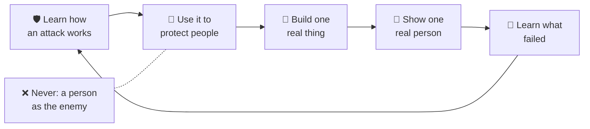

<!-- i18n-source-sha: 1e5d53cde29ad3f6 -->
<div align="center">

# 🛡️ Shepherd's Academy of War · 🌱 Daniel &amp; David

**🌐 Read this in:** English · [中文](README.zh.md) · [한국어](README.ko.md) · [日本語](README.ja.md) · [Español](README.es.md) · [Deutsch](README.de.md) · [Français](README.fr.md) &nbsp;<sub>(English is the source of truth; the rest are AI-assisted and may lag)</sub>

### 攻撃がどのように機能するかを学び、守る者として生きる力を身につけましょう。賢く、創造的で、AI時代に備えたビルダーに、みんなでなろう。

**父と二人の息子が車の中で始めた家族アカデミーです。勇気、スキル、そしてBuilder Loop（ビルダーループ）を、大人も子ども（およそ5〜15歳）も一緒に学びます。**

<a href="https://daniel-and-david.vercel.app/">
  
</a>

**[▶️ Shepherd's World Model（シェパードの世界モデル）をプレイ →](https://agentic-portfolio-lovat.vercel.app/play/shepherd.html)** ·
**[Builder Loopアプリ →](https://daniel-and-david.vercel.app/app.html)** ·
**[SAWシリーズを読む →](https://agentic-portfolio-lovat.vercel.app/articles/saw-academy-of-war-learn-the-attack.html)** ·
**[申し込み →](https://daniel-and-david.vercel.app/#apply)**

<a href="https://daniel-and-david.vercel.app/">
  
</a>

</div>

> **正直な現状（2026-10-16）。** Shepherd's Academy of War（SAW、シェパーズ・アカデミー・オブ・ウォー）は開始から数週間です。**インストラクターはまだ確定しておらず**、**何もまだ測定されていません**。その公開名もまだ試用中です（[シグナルを参照](#-the-signal-is-this-working)）。現在動いているのは、Builder Loopアプリ、3つの小さな家族向けアプリ、そして1つのゲーム型ドリル「Shepherd's World Model」です。

---

## 📰 ニュース

- **2026-10-16 · 初のプレイ可能なドリル：Shepherd's World Model。** 羊飼いが狼の秘密の習性を学び、2つの群れを守ります。これはAI分野で最小の実用的な*世界モデル*（スタンフォードCS229 §19.3）で、7歳でも遊べます。15分の英語・中文スクリプト：[`docs/saw/drills/shepherd-world-model.md`](docs/saw/drills/shepherd-world-model.md)。大人向けエッセイ：[World Models Start in Six Lines of CS229](https://agentic-portfolio-lovat.vercel.app/articles/world-models-start-in-cs229.html)。
- **2026-10-16 · 4つの年齢での数の話。** 1つの数学的アイデア（「数はその名前ではない」）を、7歳・11歳・15歳・20歳向けに正直に書きました（Shifeng Chenとの共著）。7歳向けは親子で演じる台本です：[What Is a Number?](https://agentic-portfolio-lovat.vercel.app/articles/number-is-not-its-name.html)
- **2026-10-12 · SAWシリーズを公開、まだ何も作られる前に。** 5本の記事でアイデアを公開テスト（[計画とスコアボード](docs/saw/SERIES.md)）。
- **以前 · Builder Loopアプリ、Apps Gallery、Founding Familiesコホート**が公開されました。[CHANGELOG.md](CHANGELOG.md)を参照。

---

## 🧒 仕組み — 10歳でも理解できて描き直せる



**言葉で説明すると：**
1. 何かがどう攻撃するかを学ぶ：狼の習性、詐欺、いじめの手口、壊れた計画など。
2. その知識を使って守る。
3. 小さくても本物のものを作る。
4. 本物の人に見せる。
5. 失敗から学び、また一周する。

唯一絶対に曲げないルール：**人を敵にしない。** 戦うのは「攻撃」であって、人間そのものではありません。

---

## これは何か — 1つのアカデミーへの3つの扉

| 扉 | そこで起こること | どこにあるか |
|---|---|---|
| **1 · アカデミー（SAW）** | 子どものための勇気とスキル：攻撃がどう機能するかを学び、守る者として生きる。スキルの使い道に関する5つの法則。ゲストインストラクターのルール：**内容（コンテンツ）、接触（コンタクト）なし**。子どもが大人と二人きりになることはありません。負けも記録できるスコアカード。 | [5部作シリーズ](https://agentic-portfolio-lovat.vercel.app/articles/saw-academy-of-war-learn-the-attack.html) · [`docs/saw/`](docs/saw/) · [研究](docs/research/shepherd-warrior-formation.md) |
| **2 · フィールドラボ（Daniel & David）** | **[Builder Loop](docs/builder-loop/)**：4週間の家族実験を5回のビルド・見せる・学ぶサイクルで回します。AIはチームメイト、あなたは頭脳と良心。ベンチャー、カリキュラム、原則。 | [`docs/builder-loop/`](docs/builder-loop/) · [`docs/curriculum/`](docs/curriculum/) · [`ventures/`](ventures/) |
| **3 · ドリルとデモ** | 家族で15〜20分でできること：週1回の**車内ドリル**（SAWパート5）と**Shepherd's World Model**ゲーム。さらに小さなアプリ（Conversation Spark、Transition Timer、Homework Chunker、Up a Dimension）。 | [`docs/saw/drills/`](docs/saw/drills/) · [Apps Gallery](https://daniel-and-david.vercel.app/apps.html) |

---

## ⚡ クイックスタート

**👪 家族向け（コード不要・インストール不要）：**
1. [Shepherd's World Modelをプレイ](https://agentic-portfolio-lovat.vercel.app/play/shepherd.html)（[15分スクリプト](docs/saw/drills/shepherd-world-model.md)付き）。
2. 無料の[Builder Loopアプリ](https://daniel-and-david.vercel.app/app.html)を開く。サインアップ不要、ホーム画面に追加でき、データはすべて端末内に保存されます。
3. 始める前に[安全ルール](docs/safety/)を読んでください。

**🛠️ 開発者・コントリビューター向け：**
```bash
git clone https://github.com/wjlgatech/daniel-and-david.git && cd daniel-and-david
./scripts/setup.sh        # スクリプトを実行可能にし、すべてのガードレールを実行
./scripts/check.sh        # PR前の最終チェック（CIと同じガードレール）
./scripts/saw-signal.sh   # SAWは動いているか？4つの数字と補足の1つを表示
```

---

## 🧭 ここでできること

| やりたいこと | 行き先 |
|---|---|
| 今夜15分で家族ドリルをやりたい | [Shepherd's World Modelスクリプト](docs/saw/drills/shepherd-world-model.md)（EN + 中文）→ [ゲーム](https://agentic-portfolio-lovat.vercel.app/play/shepherd.html) |
| 週1回の車内ドリルをやりたい | [SAWパート5：1つのドリル、4つの数字、6つのトリップワイヤー](https://agentic-portfolio-lovat.vercel.app/articles/saw-scorecard-drill-numbers-tripwires.html) |
| 4週間の家族プロジェクトを始めたい | [Builder Loop](docs/builder-loop/) → [アプリ](https://daniel-and-david.vercel.app/app.html) · [印刷用](docs/builder-loop/printable.md) |
| SAWが機能しているか知りたい | `./scripts/saw-signal.sh` · 台帳 [`docs/saw/signal.json`](docs/saw/signal.json) |
| 「war（戦争）」という言葉が残る理由を知りたい | [SAWパート1](https://agentic-portfolio-lovat.vercel.app/articles/saw-academy-of-war-learn-the-attack.html) |
| ゲスト専門家を安全に招待したい | [SAWパート4：内容（コンテンツ）、接触（コンタクト）なし](https://agentic-portfolio-lovat.vercel.app/articles/saw-guest-instructors-content-not-contact.html) |
| 創設家族として参加したい | [Founding Families](docs/founding-families.md)（⛏️ Genesis · 8枠） |
| 貢献したい | [CONTRIBUTING.md](CONTRIBUTING.md) · [AGENTS.md](AGENTS.md) |

---

## 📚 執筆物

長文記事は著者の[agentic portfolio](https://agentic-portfolio-lovat.vercel.app/#writing)に掲載されています。すべて5言語（英語・中文・スペイン語・韓国語・日本語）で読めます。

| 記事 | 対象 | リンク |
|---|---|---|
| SAW 1 · 子どものためのAcademy of War：攻撃を学び、守る者として生きる | 保護者、リーダー | [読む](https://agentic-portfolio-lovat.vercel.app/articles/saw-academy-of-war-learn-the-attack.html) |
| SAW 2 · ヨハネの黙示録19には一人の戦士、長い戦いには5つの舞台 | 保護者 | [読む](https://agentic-portfolio-lovat.vercel.app/articles/saw-revelation-19-one-fighter.html) |
| SAW 3 · 子どものための勇気トレーニング：証拠が支持すること・逆効果なこと | 保護者 | [読む](https://agentic-portfolio-lovat.vercel.app/articles/saw-courage-training-evidence.html) |
| SAW 4 · 子どものためのゲストインストラクター：内容（コンテンツ）、接触（コンタクト）なし | 保護者、ゲスト | [読む](https://agentic-portfolio-lovat.vercel.app/articles/saw-guest-instructors-content-not-contact.html) |
| SAW 5 · 家族アカデミーのスコアカード：1つの車内ドリル、4つの数字、6つのトリップワイヤー | 保護者、リーダー | [読む](https://agentic-portfolio-lovat.vercel.app/articles/saw-scorecard-drill-numbers-tripwires.html) |
| World Models Start in Six Lines of CS229（とShepherd's World Model） | エンジニア；ドリルは7〜11歳向け | [読む](https://agentic-portfolio-lovat.vercel.app/articles/world-models-start-in-cs229.html) · [プレイ](https://agentic-portfolio-lovat.vercel.app/play/shepherd.html) |
| What Is a Number?（4つの年齢の数、7歳向け） | 子ども＋大人 | [読む](https://agentic-portfolio-lovat.vercel.app/articles/number-is-not-its-name.html) |
| Number Systems（11歳）· Place Value（15歳）· Number vs Representation（20歳） | 11歳、15歳、20歳 | [11](https://agentic-portfolio-lovat.vercel.app/articles/number-systems-from-tally-to-place-value.html) · [15](https://agentic-portfolio-lovat.vercel.app/articles/place-value-ten-symbols-every-number.html) · [20](https://agentic-portfolio-lovat.vercel.app/articles/number-vs-representation-for-programmers.html) · [プレイ](https://agentic-portfolio-lovat.vercel.app/play/numbers.html) |

---

## 🎯 固定された意思決定（その理由）

- **人を敵にしない。** スキルは「攻撃」に向けられ、人には向けません。人に対する暴力的な言葉はシリーズの基準を満たしません。
- **内容（コンテンツ）、接触（コンタクト）なし。** ゲスト専門家は録画または監督付きの内容で教え、子どもが大人と二人きりになることはありません。安全ルール：[`docs/safety/`](docs/safety/)。
- **測定されていないことは主張しない。** 台帳に記録されるまで「まだ何も測定されていない」と明記し、`faculty_confirmed`が0の間はインストラクターも主張しません。
- **シグナルが先、構築は後。** 4つの数字が合格するまでSAWの構築はありません（[シグナル](#-the-signal-is-this-working)参照）。Shepherd's World Modelはポートフォリオデモであり、SAW本体の構築物ではありません。
- **能力を測る、お金ではない。** 子どもが「押し付けられずに」できることを測定します（[Theory of Change（変化の理論）](docs/vision/theory-of-change.md)）、下記のCapability Ladder（能力のはしご）参照。

---

## 📏 シグナル：これは機能しているか？

SAWシリーズは「拍手」ではなく「意思決定」を生み出すために書かれました。**2026-11-11**までに、[`signal.json`](docs/saw/signal.json)にこれらの数字が入っている必要があります。`./scripts/saw-signal.sh`はそれらを表示し、期日後に1つでも欠けていれば終了コード1で返します。

| 数字 | 合格基準 | 何を決めるか |
|---|---|---|
| `strangers_asked`, `strangers_heard_militant` | 20人以上に尋ね、半数未満が「militant（好戦的）」と感じる | 公開名が残るか（このリポジトリ名も含む） |
| `reader_mission_numbers` | 読者による10件以上のミッション結果投稿 | 私たち以外が実行しているか |
| `outside_reviewers_of_guest_rules` | パート4の子ども安全審査者が1人以上 | 初のゲストを招待できるか |
| `family_drills_run` | 週1回の車内ドリルを4回以上、子ども自身のカードで | 7歳児でもドリルが続くか |
| *補足:* `shepherd_demo_drills` | カウントのみ、合否なし | Shepherd's World Modelを実施した家族数（4回にはカウントしない） |

**現状：** 4つ中0つが測定済み。3週目としては正直な数字ですが、2026-11-11にまだ同じなら大きく公表します。

---

## 🏷️ 名前について（およびこのリポジトリ名について）

このリポジトリは意図的に`daniel-and-david`のままです。SAW自身のルールで公開名は**2026-11-11**まで試用中：20人に尋ねて半数未満が「militant（好戦的）」と感じれば公開名が残ります。リポジトリ名を先に変えると、データが出る前にテスト結果を決めてしまうことになります。

もし名前が合格したら、リネームは1コマンドです：
```bash
gh repo rename shepherds-academy-of-war --repo wjlgatech/daniel-and-david
```
GitHubは古いリポジトリURLとgitリモートをリダイレクトし、daniel-and-david.vercel.appのライブサイトは影響を受けません。
**唯一壊れるのは：** GitHub Pagesのアドレス（`wjlgatech.github.io/daniel-and-david/`）が移動すること。そのため、リネーム時にはREADMEと`apps/web`内のPagesリンクもすべて更新する必要があります。

もし名前が不合格なら、SAWは家族内のプライベート名のまま、このリポジトリもフィールドラボ名のままです。

---

## 私たちが実際に登るはしご

私たちが測るのは**能力**であり、お金ではありません。公開されるはしごは、誰でも（子どもも大人も）*できること*です：

<p align="center"></p>

*このゲームは、登る中で自分がどう変わるかです。* 上級ベンチャートラックもありますが、意図的に下位に配置しています。[はしごの詳細](docs/vision/milestones.md)参照。

---

## ビルダーはどう作られるか

講義からではありません。**本物のものを1つ、最初から最後まで作り、それがなぜうまくいったか・いかなかったかをすべて学ぶ**ことで育ちます。

<p align="center"></p>

- **ベンチャー。** [`ventures/kc-matchday-basecamp/`](ventures/kc-matchday-basecamp/)はカンザスシティのフットボール夏季向け、法的・会場パートナー付きのファン向けユーティリティ＆ローカルコマース構想です。**仕様✅完成；Webアプリ🟡未着手。**
- **カリキュラム。** 1つの方法をすべての年齢で：
  - [Daniel（11歳）](docs/curriculum/daniel-age-11/)：作り、値付けし、売り、測定し、[AI Build Kit](docs/curriculum/daniel-age-11/build-kit.md)をリード
  - [David（6歳）](docs/curriculum/david-age-6/)：数を数え、サインを描き、顧客を迎える
  - [クリティカルシンキング](docs/curriculum/critical-thinking/)：5W1Hグリッド、[AIチームメイトにも組み込み済み](.claude/README.md)
- **原則：**
  - [AI-Native Company](docs/principles/ai-native-company.md)
  - [Agentic Engineering](docs/principles/agentic-engineering.md)
  - [Pain2Gain](docs/principles/pain2gain.md)
  - [Values](docs/principles/values.md)

<p align="center"></p>

### 設計中、未リリース

- 🗣️ **Builder Loop Coach。** 音声中心のコーチが同じループを会話で回します。データは端末内に保存され、常にAIであることが明確です。[`apps/web-agent/`](apps/web-agent/)参照。
- 🌿 **イザヤ35回復トラック**は荒れた季節の大人向け。4つの原則（回復、贖い、再生、復活）を同じループで使います。信仰に根ざし、誰でも歓迎。[トラック詳細](docs/vision/isaiah-35-restoration.md)、[4週間回復ループ](docs/curriculum/adult-restoration/)参照。
- 🌍 **ハブ。** 生きた学びのハブ、ツールハブ、コラボレーションハブ。保護者、子ども、エンジニア、創業者、AIエージェントに開かれています。[ハブガイド](docs/community/hub.md)参照。

---

## 🗺️ リポジトリ構成

```
daniel-and-david/                 （Shepherd's Academy of Warのホーム；名前決定は2026-11-11）
├── docs/
│   ├── saw/             🛡️ SAW：シリーズ計画、シグナル台帳、drills/（Shepherd's World Modelスクリプト、EN + 中文）
│   ├── builder-loop/    ⭐ 4週間の家族Builder Loop、フィールドラボの基本単位
│   ├── founding-families.md  🧱 The Halving：創設コホートへの申し込み
│   ├── vision/          ミッション、変化の理論＋北極星、2つのはしご、回復トラック
│   ├── safety/          子どもの安全、プライバシー、同意、モデレーション、AI利用範囲
│   ├── research/        引用研究、SAWの背後にあるshepherd-warrior formationの調査書
│   ├── principles/      働き方：AIネイティブ、エージェンティックエンジニアリング、価値観
│   ├── curriculum/      Daniel（11）、David（6）、クリティカルシンキング、大人の回復
│   ├── marketing/       長文ストーリーとLinkedIn投稿用素材
│   ├── community/       ハブガイド
│   └── assets/          このREADMEで使われるインフォグラフィック（SVG）
├── apps/web/            ライブサイト（daniel-and-david.vercel.app）：ランディング、Builder Loopアプリ、デモ
├── apps/web-agent/      🟡 Builder Loop Coach（設計中の仕様）
├── ventures/            ベンチャー#1：kc-matchday-basecamp
├── agents/hello-agent/  小さなスターターエージェント
├── scripts/             setup.sh · check.sh（ガードレール）· saw-signal.sh（SAW判定）
├── .claude/             エージェントツールキット：スキル、ワークフロー、フック
└── .github/             CI、テンプレート、コントリビューター用オンランプ
```

---

## 🛠️ 開発

```bash
./scripts/check.sh   # すべてのガードレール：リンク・ツールキット・現状の真実・登録安全・Webアプリ（CIと同じ）
```

グリーンなら、すべてのリンクが有効、ドキュメントの現状主張が真実、登録フォームが安全、Webアプリが動作しています。エージェント関連は[AGENTS.md](AGENTS.md)と[.claude/README.md](.claude/README.md)を最初に読んでください。直近の目標は**10家族が本物のBuilder Loopを1つ完走すること**、そしてSAWの4つの数字が期日に揃うことです。

> 🧱 **創設家族**はスタジオ独自のAIワークショップ（AnyAgent、Super U、DreamMakeTrue）に先行して非公開でアクセスできます。[Founding Families](docs/founding-families.md)参照。

---

## 📖 ドキュメント

| ドキュメント | 内容 |
|---|---|
| [`docs/saw/SERIES.md`](docs/saw/SERIES.md) | SAWの計画、10Xの定義（失敗可能な形）、創設者だけが決める意思決定 |
| [`docs/saw/drills/shepherd-world-model.md`](docs/saw/drills/shepherd-world-model.md) | 15分Shepherd's World Modelドリル台本（英語・中文） |
| [`docs/research/shepherd-warrior-formation.md`](docs/research/shepherd-warrior-formation.md) | SAWの背後にある調査書 |
| [`docs/builder-loop/`](docs/builder-loop/) | Builder Loopガイド、印刷用、イテレーション記録 |
| [`docs/safety/`](docs/safety/) | 子どもの安全・プライバシー・同意ルール（活動前に必読） |
| [`docs/vision/theory-of-change.md`](docs/vision/theory-of-change.md) | 因果モデルと唯一追跡する指標 |
| [`docs/founding-families.md`](docs/founding-families.md) | 創設コホートと半減スケジュール |
| [`docs/marketing/the-daniel-and-david-story.md`](docs/marketing/the-daniel-and-david-story.md) | 10歳でも分かるストーリー、懐疑派にも引用多数 |

---

## 私たちの基準

<p align="center"></p>

- **常に合法で正直。** 信頼されることで勝ち、抜け道では勝ちません。
- **小さくても本物を出す。** 動くものは完璧な計画に勝ります。
- **作りながら教える。** 6歳が「なぜ」を理解できなければ、もっと分かりやすく説明します。
- **成長しながら与える。** 寛大さはモデルに組み込まれており、後付けではありません。

---

## ライセンス

[MIT](LICENSE)。オープンに作られ、学ぶのも、発展させるのも自由です。

<p align="center"><i>攻撃を学び、守る者として生きる。良いものを作り、それで人を祝福しよう。— for Daniel &amp; David</i></p>
