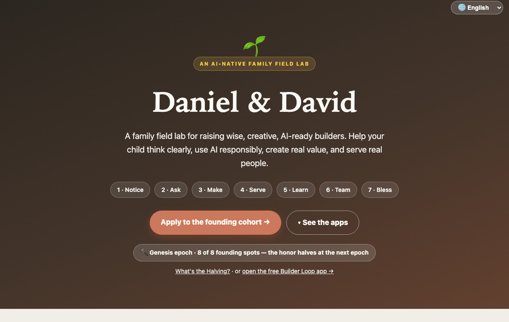
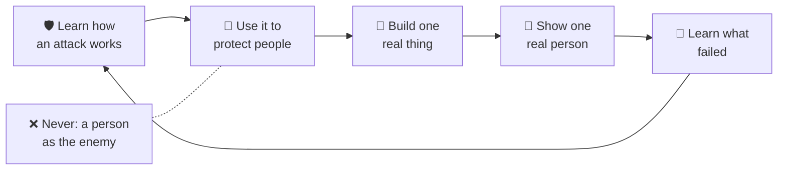
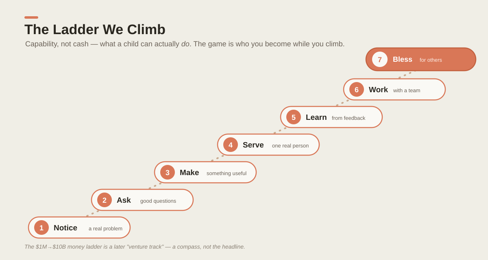
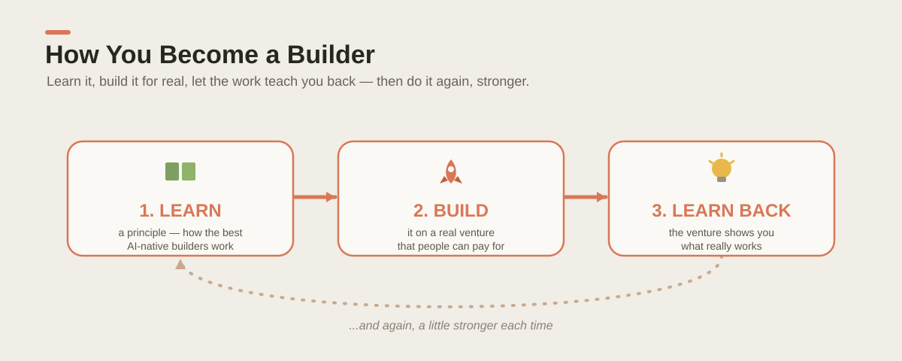
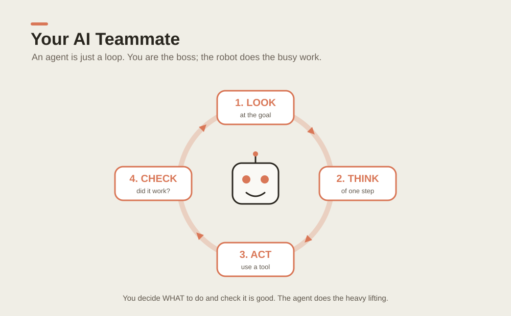
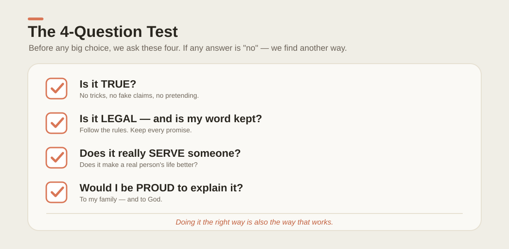

<!-- i18n-source-sha: 1e5d53cde29ad3f6 -->
<div align="center">

# 🛡️ Shepherd's Academy of War · 🌱 Daniel &amp; David

**🌐 Read this in:** English · [中文](README.zh.md) · [한국어](README.ko.md) · [日本語](README.ja.md) · [Español](README.es.md) · [Deutsch](README.de.md) · [Français](README.fr.md) &nbsp;<sub>(English is the source of truth; the rest are AI-assisted and may lag)</sub>

### 공격이 어떻게 작동하는지 배우고, 보호자로 살아가세요. 함께 지혜롭고 창의적인, AI에 준비된 빌더가 되어보세요.

**아버지와 두 아들이 자동차 안에서 시작한 가족 아카데미입니다. 용기, 기술, 그리고 Builder Loop(빌더 루프)는 어른과 아이(약 5–15세)가 나란히 함께합니다.**

<a href="https://daniel-and-david.vercel.app/">
  
</a>

**[▶️ Shepherd's World Model(셰퍼드의 월드 모델) 플레이 →](https://agentic-portfolio-lovat.vercel.app/play/shepherd.html)** ·
**[Builder Loop(빌더 루프) 앱 →](https://daniel-and-david.vercel.app/app.html)** ·
**[SAW(셰퍼드의 아카데미 오브 워) 시리즈 읽기 →](https://agentic-portfolio-lovat.vercel.app/articles/saw-academy-of-war-learn-the-attack.html)** ·
**[지원하기 →](https://daniel-and-david.vercel.app/#apply)**

<a href="https://daniel-and-david.vercel.app/">
  
</a>

</div>

> **정직한 현황 (2026-10-16).** Shepherd's Academy of War (SAW, 셰퍼드의 아카데미 오브 워)는 시작한 지 몇 주밖에 되지 않았습니다. **확정된 강사는 없습니다**, 그리고 **아직 아무것도 측정된 것이 없습니다**. 공식 명칭도 여전히 시험 중입니다 ([신호 보기](#-the-signal-is-this-working)). 현재 운영 중인 것은 Builder Loop(빌더 루프) 앱, 세 개의 작은 가족 앱, 그리고 하나의 게임 기반 훈련인 Shepherd's World Model(셰퍼드의 월드 모델)입니다.

---

## 📰 소식

- **2026-10-16 · 첫 번째 플레이 가능한 훈련: Shepherd's World Model(셰퍼드의 월드 모델).** 목동이 두 무리를 지키기 위해 늑대의 비밀 습관을 배웁니다. 이것은 AI에서 가장 작은 실제 *월드 모델*입니다 (Stanford CS229 §19.3), 7세 어린이도 플레이할 수 있습니다. 15분짜리 대본(영어/중국어): [`docs/saw/drills/shepherd-world-model.md`](docs/saw/drills/shepherd-world-model.md). 어른을 위한 에세이: [World Models Start in Six Lines of CS229](https://agentic-portfolio-lovat.vercel.app/articles/world-models-start-in-cs229.html).
- **2026-10-16 · 네 연령대의 수(數).** 하나의 수학 아이디어("수는 그 이름이 아니다")를 7, 11, 15, 20세를 위해 솔직하게 썼습니다. 7세용은 부모와 아이가 함께하는 연극 대본입니다: [What Is a Number?](https://agentic-portfolio-lovat.vercel.app/articles/number-is-not-its-name.html)
- **2026-10-12 · SAW(셰퍼드의 아카데미 오브 워) 시리즈가, 아무것도 만들어지기 전에 공개됨.** 다섯 개의 글이 아이디어를 공개적으로 시험합니다. 이름도 포함([계획 및 점수판](docs/saw/SERIES.md)).
- **이전 소식 · Builder Loop(빌더 루프) 앱, 앱 갤러리, Founding Families(창립 가족) 코호트**가 오픈되었습니다. [CHANGELOG.md](CHANGELOG.md) 참고.

---

## 🧒 어떻게 작동하나요 — 10살도 따라 그리고 다시 그릴 수 있습니다



**설명:**
1. 어떤 것이 공격하는지 배웁니다: 늑대의 습관, 사기, 괴롭힘, 잘못된 계획 등.
2. 그 지식을 이용해 보호합니다.
3. 작고 실제적인 무언가를 만듭니다.
4. 진짜 한 사람에게 보여줍니다.
5. 실패한 것에서 배우고, 다시 한 바퀴 돕니다.

절대 꺾이지 않는 한 가지 규칙: **어떤 사람도 적이 될 수 없습니다.** 우리가 싸우는 것은 공격이지, 인간이 아닙니다.

---

## 무엇인가요 — 하나의 아카데미로 들어가는 세 개의 문

| 문 | 그곳에서 일어나는 일 | 위치 |
|---|---|---|
| **1 · The Academy (SAW, 셰퍼드의 아카데미 오브 워)** | 아이들을 위한 용기와 기술: 공격이 어떻게 작동하는지 배우고, 보호자로 살아갑니다. 그 기술이 어디에 쓰일 수 있는지에 대한 다섯 가지 법칙. 게스트 강사 규칙: **콘텐츠, 접촉 금지** — 어떤 아이도 어른과 단둘이 있지 않습니다. 패배도 기록할 수 있는 점수판. | [다섯 파트 시리즈](https://agentic-portfolio-lovat.vercel.app/articles/saw-academy-of-war-learn-the-attack.html) · [`docs/saw/`](docs/saw/) · [연구](docs/research/shepherd-warrior-formation.md) |
| **2 · The Field Lab (Daniel & David, 다니엘 & 데이비드)** | **[Builder Loop(빌더 루프)](docs/builder-loop/)**: 4주간 가족이 다섯 번의 빠른 빌드-공유-학습 사이클을 도는 실험. AI는 팀원이고, 당신은 마음과 양심입니다. 벤처, 커리큘럼, 원칙. | [`docs/builder-loop/`](docs/builder-loop/) · [`docs/curriculum/`](docs/curriculum/) · [`ventures/`](ventures/) |
| **3 · Drills and demos(훈련과 데모)** | 가족이 15–20분 만에 할 수 있는 것들: 주간 **자동차 훈련**(SAW 5부)과 **Shepherd's World Model(셰퍼드의 월드 모델)** 게임. 그리고 작은 앱들(Conversation Spark, Transition Timer, Homework Chunker, Up a Dimension). | [`docs/saw/drills/`](docs/saw/drills/) · [Apps Gallery](https://daniel-and-david.vercel.app/apps.html) |

---

## ⚡ 빠른 시작

**👪 가족(코드/설치 필요 없음):**
1. [Shepherd's World Model(셰퍼드의 월드 모델)](https://agentic-portfolio-lovat.vercel.app/play/shepherd.html)을 [15분 대본](docs/saw/drills/shepherd-world-model.md)과 함께 플레이하세요.
2. 무료 [Builder Loop(빌더 루프) 앱](https://daniel-and-david.vercel.app/app.html)을 열어보세요. 회원가입 필요 없고, 홈 화면에 설치할 수 있으며, 모든 데이터가 기기에만 저장됩니다.
3. 시작 전에 [안전 규칙](docs/safety/)을 읽으세요.

**🛠️ 개발자 및 기여자:**
```bash
git clone https://github.com/wjlgatech/daniel-and-david.git && cd daniel-and-david
./scripts/setup.sh        # 스크립트 실행 가능하게 하고 모든 가드레일 실행
./scripts/check.sh        # PR 전 마지막 점검(동일한 가드레일을 CI에서 실행)
./scripts/saw-signal.sh   # SAW가 작동 중인가? 네 개 숫자와 보조 숫자 출력
```

---

## 🧭 여기서 할 수 있는 것

| 원하는 것 | 바로가기 |
|---|---|
| 오늘 밤 15분 가족 훈련 실행 | [Shepherd's World Model 대본](docs/saw/drills/shepherd-world-model.md) (EN + 中文) → [게임](https://agentic-portfolio-lovat.vercel.app/play/shepherd.html) |
| 주간 자동차 훈련 실행 | [SAW 5부: 한 번의 훈련, 네 개의 숫자, 여섯 개의 트립와이어](https://agentic-portfolio-lovat.vercel.app/articles/saw-scorecard-drill-numbers-tripwires.html) |
| 4주 가족 프로젝트 시작 | [Builder Loop(빌더 루프)](docs/builder-loop/) → [앱](https://daniel-and-david.vercel.app/app.html) · [프린트용](docs/builder-loop/printable.md) |
| SAW가 작동 중인지 확인 | `./scripts/saw-signal.sh` · 원장 [`docs/saw/signal.json`](docs/saw/signal.json) |
| "war(전쟁)"이라는 단어가 왜 남아있는지 이해 | [SAW 1부](https://agentic-portfolio-lovat.vercel.app/articles/saw-academy-of-war-learn-the-attack.html) |
| 게스트 전문가를 안전하게 초대 | [SAW 4부: 콘텐츠, 접촉 금지](https://agentic-portfolio-lovat.vercel.app/articles/saw-guest-instructors-content-not-contact.html) |
| 창립 가족으로 참여 | [Founding Families(창립 가족)](docs/founding-families.md) (⛏️ Genesis · 8자리) |
| 기여하기 | [CONTRIBUTING.md](CONTRIBUTING.md) · [AGENTS.md](AGENTS.md) |

---

## 📚 글 모음

장문의 글들은 저자의 [agentic portfolio](https://agentic-portfolio-lovat.vercel.app/#writing)에 있습니다. 각각 다섯 개 언어(영어, 중국어, 스페인어, 한국어, 일본어)로 제공됩니다.

| 글 | 대상 | 링크 |
|---|---|---|
| SAW 1 · An Academy of War for Children: Learn the Attack, Live as a Protector | 부모, 리더 | [읽기](https://agentic-portfolio-lovat.vercel.app/articles/saw-academy-of-war-learn-the-attack.html) |
| SAW 2 · Revelation 19 Has One Fighter, and the Long War Has Five Arenas | 부모 | [읽기](https://agentic-portfolio-lovat.vercel.app/articles/saw-revelation-19-one-fighter.html) |
| SAW 3 · Courage Training for Children: What the Evidence Supports and What Backfires | 부모 | [읽기](https://agentic-portfolio-lovat.vercel.app/articles/saw-courage-training-evidence.html) |
| SAW 4 · Guest Instructors for Children: Content, Not Contact | 부모, 게스트 | [읽기](https://agentic-portfolio-lovat.vercel.app/articles/saw-guest-instructors-content-not-contact.html) |
| SAW 5 · A Scorecard for a Family Academy: One Car-Ride Drill, Four Numbers, Six Tripwires | 부모, 리더 | [읽기](https://agentic-portfolio-lovat.vercel.app/articles/saw-scorecard-drill-numbers-tripwires.html) |
| World Models Start in Six Lines of CS229 (and the Shepherd's World Model) | 엔지니어; 훈련은 7–11세 대상 | [읽기](https://agentic-portfolio-lovat.vercel.app/articles/world-models-start-in-cs229.html) · [플레이](https://agentic-portfolio-lovat.vercel.app/play/shepherd.html) |
| What Is a Number? (Numbers at Four Ages, age 7) | 아이 + 어른 | [읽기](https://agentic-portfolio-lovat.vercel.app/articles/number-is-not-its-name.html) |
| Number Systems (age 11) · Place Value (age 15) · Number vs Representation (age 20) | 11, 15, 20세 | [11](https://agentic-portfolio-lovat.vercel.app/articles/number-systems-from-tally-to-place-value.html) · [15](https://agentic-portfolio-lovat.vercel.app/articles/place-value-ten-symbols-every-number.html) · [20](https://agentic-portfolio-lovat.vercel.app/articles/number-vs-representation-for-programmers.html) · [플레이](https://agentic-portfolio-lovat.vercel.app/play/numbers.html) |

---

## 🎯 확정된 결정(그리고 그 이유)

- **어떤 사람도 적이 될 수 없습니다.** 기술은 공격에만 사용되고, 사람에게는 사용되지 않습니다. 사람에 대한 폭력적 언어는 시리즈의 자체 기준을 통과하지 못합니다.
- **콘텐츠, 접촉 금지.** 게스트 전문가는 녹화 또는 감독된 콘텐츠로만 가르치며, 어떤 아이도 어른과 단둘이 있지 않습니다. 안전 규칙: [`docs/safety/`](docs/safety/).
- **측정되지 않은 것은 주장하지 않습니다.** 원장에 기록되기 전까지 "아직 아무것도 측정되지 않았다"고 밝히며, `faculty_confirmed`가 0인 동안 강사가 있다고 주장하지 않습니다.
- **빌드 전에 신호.** 네 개의 숫자가 통과하기 전까지 SAW 빌드는 없습니다([신호](#-the-signal-is-this-working) 참고). Shepherd's World Model(셰퍼드의 월드 모델)은 SAW가 빌려 쓰는 포트폴리오 데모이지, SAW의 빌드가 아닙니다.
- **역량, 돈이 아님.** 우리는 아이가 강요받지 않고 할 수 있는 것을 측정합니다([변화 이론](docs/vision/theory-of-change.md)), 아래의 Capability Ladder(역량 사다리) 참고.

---

## 📏 신호: 이게 작동하고 있나요?

SAW(셰퍼드의 아카데미 오브 워) 시리즈는 박수가 아니라 결정을 위해 쓰였습니다. **2026-11-11**까지 [`signal.json`](docs/saw/signal.json)에 이 숫자들이 기록되어야 합니다. `./scripts/saw-signal.sh`는 이 숫자들을 출력하고, 날짜 이후에도 하나라도 없으면 1로 종료합니다.

| 숫자 | 통과 기준 | 결정 내용 |
|---|---|---|
| `strangers_asked`, `strangers_heard_militant` | 20명 이상에게 질문, 절반 미만이 "militant(군사적)"로 들음 | 공개 명칭 유지 여부(이 저장소 이름 포함) |
| `reader_mission_numbers` | 독자가 10개 이상의 미션 결과를 게시 | 우리 외에 누가 실행하는지 여부 |
| `outside_reviewers_of_guest_rules` | 1명 이상의 아동 보호 전문가가 4부 검토 | 첫 게스트 초대 가능 여부 |
| `family_drills_run` | 4회 이상의 주간 자동차 훈련(아이의 카드로) | 7세 아이도 훈련을 소화하는지 여부 |
| *보조:* `shepherd_demo_drills` | 집계만, 기준 없음 | Shepherd's World Model(셰퍼드의 월드 모델)을 실행한 가족 수(4회에 포함되지 않음) |

**현재:** 4개 중 0개 측정됨. 3주차에 솔직한 수치이며, 2026-11-11에도 그대로라면 크게 알릴 것입니다.

---

## 🏷️ 이름에 대하여(그리고 이 저장소의 이름)

저장소 이름은 일부러 아직 `daniel-and-david`입니다. SAW(셰퍼드의 아카데미 오브 워) 자체 규칙에 따라 공식 명칭은 **2026-11-11**까지 시험 중입니다: 20명 중 절반 미만이 "militant(군사적)"로 들으면 이름이 유지됩니다. 저장소를 먼저 바꾸면 데이터 없이 결과를 미리 결정하는 셈이 됩니다.

이름이 통과하면, 변경은 한 줄 명령입니다:
```bash
gh repo rename shepherds-academy-of-war --repo wjlgatech/daniel-and-david
```
GitHub는 기존 저장소 URL과 git 원격을 리다이렉트하고, daniel-and-david.vercel.app의 라이브 사이트는 영향을 받지 않습니다.
**단 한 가지만 깨집니다:** GitHub Pages 주소(`wjlgatech.github.io/daniel-and-david/`)가 이동합니다. 따라서 변경 시 이 README와 `apps/web`의 모든 Pages 링크를 함께 수정해야 합니다.

이름이 통과하지 못하면, SAW는 가족의 비공개 명칭으로 남고, 저장소는 필드랩 이름을 유지합니다.

---

## 우리가 실제로 오르는 사다리

우리는 **역량**을 측정합니다. 돈이 아닙니다. 공개 사다리는 누구나, 아이든 어른이든, *할 수 있는 것*입니다:

<p align="center"></p>

*이 게임은, 오르는 동안 당신이 어떤 사람이 되는가입니다.* 고급 벤처 트랙도 있습니다. 일부러 아래에 위치합니다. [사다리 보기](docs/vision/milestones.md).

---

## 빌더는 어떻게 만들어지는가

강의로는 만들어지지 않습니다. **실제 무언가를 처음부터 끝까지 만들어보고, 왜 성공하거나 실패했는지 모든 부분을 배우는 것**에서 시작합니다.

<p align="center"></p>

- **벤처.** [`ventures/kc-matchday-basecamp/`](ventures/kc-matchday-basecamp/)는 캔자스시티 풋볼 여름을 위한 합법적, 장소 제휴 팬 유틸리티 및 지역 상거래 컨셉입니다. **명세 ✅ 완료; 웹앱 🟡 빌드 시작 전.**
- **커리큘럼.** 한 가지 방법, 모든 연령:
  - [Daniel(다니엘), 11세](docs/curriculum/daniel-age-11/): 만들고, 가격 매기고, 판매하고, 측정하며, [AI Build Kit](docs/curriculum/daniel-age-11/build-kit.md)도 리드합니다.
  - [David(데이비드), 6세](docs/curriculum/david-age-6/): 셈하고, 표지판 그리며, 손님을 맞이합니다.
  - [비판적 사고](docs/curriculum/critical-thinking/): 5W1H 그리드, [AI 팀원에도 적용됨](.claude/README.md).
- **원칙:**
  - [AI-Native Company](docs/principles/ai-native-company.md)
  - [Agentic Engineering](docs/principles/agentic-engineering.md)
  - [Pain2Gain](docs/principles/pain2gain.md)
  - [Values](docs/principles/values.md)

<p align="center"></p>

### 설계 중, 출시 전

- 🗣️ **Builder Loop Coach(빌더 루프 코치).** 음성 기반 코치가 같은 루프를 대화로 진행합니다. 데이터는 기기에만 저장되고, 항상 AI임을 명확히 알립니다. [`apps/web-agent/`](apps/web-agent/) 참고.
- 🌿 **Isaiah 35 Restoration Track(이사야 35 회복 트랙)**은 척박한 시기의 어른을 위한 코스입니다. 네 가지 원칙(회복, 구속, 재생, 부활)을 같은 루프로 적용합니다. 신앙에 뿌리를 두었지만 모두 환영합니다. [트랙](docs/vision/isaiah-35-restoration.md)과 [4주 회복 루프](docs/curriculum/adult-restoration/) 참고.
- 🌍 **허브.** 살아있는 학습 허브, 도구 허브, 협업 허브로, 부모, 아이, 엔지니어, 창업가, AI 에이전트 모두에게 열려 있습니다. [허브 가이드](docs/community/hub.md) 참고.

---

## 🗺️ 저장소 지도

```
daniel-and-david/                 (Shepherd's Academy of War의 홈; 이름 결정 2026-11-11)
├── docs/
│   ├── saw/             🛡️ SAW: 시리즈 계획, 신호 원장, drills/ (셰퍼드의 월드 모델 대본, EN + 中文)
│   ├── builder-loop/    ⭐ 4주 가족 Builder Loop, 필드랩의 기본 단위
│   ├── founding-families.md  🧱 The Halving: 창립 코호트 지원
│   ├── vision/          미션, 변화 이론 + 북극성, 두 개의 사다리, 회복 트랙
│   ├── safety/          아동 안전, 프라이버시, 동의, 중재, AI 사용 한계
│   ├── research/        인용 연구, SAW의 목동-전사 포메이션 자료 포함
│   ├── principles/      우리의 일하는 방식: AI-native, agentic engineering, values
│   ├── curriculum/      Daniel(11), David(6), 비판적 사고, 어른 회복
│   ├── marketing/       장문의 스토리와 LinkedIn 게시글
│   ├── community/       허브 가이드
│   └── assets/          이 README에 쓰인 인포그래픽(SVG)
├── apps/web/            라이브 사이트(daniel-and-david.vercel.app): 랜딩, 빌더 루프 앱, 데모
├── apps/web-agent/      🟡 Builder Loop Coach (명세 설계 중)
├── ventures/            벤처 #1: kc-matchday-basecamp
├── agents/hello-agent/  아주 작은 스타터 에이전트
├── scripts/             setup.sh · check.sh(가드레일) · saw-signal.sh(SAW 판정)
├── .claude/             에이전트 툴킷: 스킬, 워크플로우, 훅
└── .github/             CI, 템플릿, 기여자 온램프
```

---

## 🛠️ 개발

```bash
./scripts/check.sh   # 모든 가드레일: 링크 · 툴킷 · 상태 진실 · 등록 안전 · 웹앱 (CI와 동일)
```

초록불은 모든 링크가 연결되고, 문서의 상태 주장도 사실이며, 등록 폼이 안전하고, 웹앱이 작동함을 의미합니다. 에이전트: [AGENTS.md](AGENTS.md)와 [.claude/README.md](.claude/README.md)를 먼저 읽으세요. 우리의 단기 목표는 기여량이 아니라, **열 가족이 실제 Builder Loop(빌더 루프)를 완주하는 것**과 SAW의 네 숫자가 날짜에 맞춰 기록되는 것입니다.

> 🧱 **창립 가족**은 스튜디오 자체 AI 워크숍(AnyAgent, Super U, DreamMakeTrue)에 비공개로 먼저 접근할 수 있습니다.
> [Founding Families(창립 가족)](docs/founding-families.md) 참고.

---

## 📖 문서

| 문서 | 내용 |
|---|---|
| [`docs/saw/SERIES.md`](docs/saw/SERIES.md) | SAW 계획, 실패할 수 있도록 정의된 10X, 창립자만 내릴 수 있는 결정 |
| [`docs/saw/drills/shepherd-world-model.md`](docs/saw/drills/shepherd-world-model.md) | 15분짜리 Shepherd's World Model(셰퍼드의 월드 모델) 훈련 대본(영어/중국어) |
| [`docs/research/shepherd-warrior-formation.md`](docs/research/shepherd-warrior-formation.md) | SAW의 뒷받침이 되는 연구 자료 |
| [`docs/builder-loop/`](docs/builder-loop/) | Builder Loop(빌더 루프) 가이드, 프린트용, 반복 기록 |
| [`docs/safety/`](docs/safety/) | 아동 안전, 프라이버시, 동의 규칙(모든 활동 전 필독) |
| [`docs/vision/theory-of-change.md`](docs/vision/theory-of-change.md) | 인과 모델과 우리가 추적하는 단 하나의 지표 |
| [`docs/founding-families.md`](docs/founding-families.md) | 창립 코호트와 절반 나누기 일정 |
| [`docs/marketing/the-daniel-and-david-story.md`](docs/marketing/the-daniel-and-david-story.md) | 10살도 이해할 수 있고, 회의론자도 납득할 수 있는 스토리 |

---

## 우리가 지키는 기준

<p align="center"></p>

- **항상 합법적이고 정직하게.** 우리는 신뢰로 이기지, 편법으로 이기지 않습니다.
- **작게, 실제로 출시.** 작동하는 것이 완벽한 계획보다 낫습니다.
- **만들면서 가르치기.** 6세도 *왜*를 이해하지 못하면, 더 잘 설명합니다.
- **성장하며 나누기.** 관대함은 모델에 내장되어 있고, 나중에 덧붙이는 것이 아닙니다.

---

## 라이선스

[MIT](LICENSE). 공개적으로 만들어졌으며, 누구나 배우고, 기반하여 만들 수 있습니다.

<p align="center"><i>공격을 배우고, 보호자로 살아가세요. 좋은 것을 만드세요. 그것으로 축복하세요. — for Daniel &amp; David</i></p>
