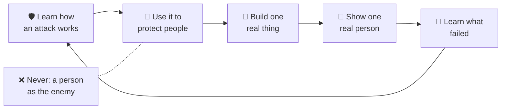

<div align="center">

# 🛡️ Shepherd's Academy of War · 🌱 Daniel &amp; David

**🌐 Read this in:** English · [中文](README.zh.md) · [한국어](README.ko.md) · [日本語](README.ja.md) · [Español](README.es.md) · [Deutsch](README.de.md) · [Français](README.fr.md) &nbsp;<sub>(English is the source of truth; the rest are AI-assisted and may lag)</sub>

### Learn how an attack works, so you can live as a protector. Become a wise, creative, AI-ready builder, together.

**A family academy started on car rides by a father and his two sons. Courage, skill and the Builder Loop, for
grown-ups and children (about ages 5–15) side by side.**

<a href="https://daniel-and-david.vercel.app/">
  
</a>

**[▶️ Play the Shepherd's World Model →](https://agentic-portfolio-lovat.vercel.app/play/shepherd.html)** ·
**[Builder Loop app →](https://daniel-and-david.vercel.app/app.html)** ·
**[Read the SAW series →](https://agentic-portfolio-lovat.vercel.app/articles/saw-academy-of-war-learn-the-attack.html)** ·
**[Apply →](https://daniel-and-david.vercel.app/#apply)**

<a href="https://daniel-and-david.vercel.app/">
  
</a>

</div>

> **Honest status (2026-10-16).** Shepherd's Academy of War (SAW) is weeks old. **No instructor is confirmed**, and
> **nothing about it has been measured yet**. Its public name is still on trial (see [the signal](#-the-signal-is-this-working)).
> What runs today: the Builder Loop app, three small family apps, and one game-based drill, the Shepherd's World Model.

---

## 📰 News

- **2026-10-16 · A first drill you can play: the Shepherd's World Model.** A shepherd learns a wolf's secret habit in
  order to guard two flocks. This is the smallest real *world model* in AI (Stanford CS229 §19.3), playable by a
  7-year-old. 15-minute script in English and 中文: [`docs/saw/drills/shepherd-world-model.md`](docs/saw/drills/shepherd-world-model.md).
  Essay for grown-ups: [World Models Start in Six Lines of CS229](https://agentic-portfolio-lovat.vercel.app/articles/world-models-start-in-cs229.html).
- **2026-10-16 · Numbers at Four Ages.** One math idea ("a number is not its name"), written honestly for ages 7, 11, 15
  and 20, co-authored with Shifeng Chen. The age-7 piece is a play script for a parent and child:
  [What Is a Number?](https://agentic-portfolio-lovat.vercel.app/articles/number-is-not-its-name.html)
- **2026-10-12 · The SAW series is published, before anything was built.** Five articles test the idea in public,
  name included ([plan and scoreboard](docs/saw/SERIES.md)).
- **Earlier · The Builder Loop app, the Apps Gallery and the Founding Families cohort** went live. See [CHANGELOG.md](CHANGELOG.md).

---

## 🧒 How it works — a 10-year-old can follow (and redraw) this



**In words:**
1. Learn how something attacks: a wolf's habit, a scam, a bully's move, a broken plan.
2. Use that knowledge to protect.
3. Build something small and real.
4. Show it to one real person.
5. Learn from what failed, and go round again.

The one rule that never bends: **no person is ever the enemy.** What we fight is the attack, never the human.

---

## What it is — three doors into one academy

| Door | What happens there | Where it lives |
|---|---|---|
| **1 · The Academy (SAW)** | Courage and skill for children: learn how an attack works, so you can live as a protector. Five laws about where that skill may be aimed. A guest-instructor rule: **content, not contact**, so no child is ever alone with an adult. A scorecard that can show a loss. | The [five-part series](https://agentic-portfolio-lovat.vercel.app/articles/saw-academy-of-war-learn-the-attack.html) · [`docs/saw/`](docs/saw/) · [research](docs/research/shepherd-warrior-formation.md) |
| **2 · The Field Lab (Daniel & David)** | The **[Builder Loop](docs/builder-loop/)**: a four-week family experiment run as five fast build-show-learn cycles. AI is the teammate; you stay the mind and the conscience. Ventures, curriculum, principles. | [`docs/builder-loop/`](docs/builder-loop/) · [`docs/curriculum/`](docs/curriculum/) · [`ventures/`](ventures/) |
| **3 · Drills and demos** | Things a family can run in 15–20 minutes: the weekly **car-ride drill** (SAW part 5) and the **Shepherd's World Model** game. Plus small apps (Conversation Spark, Transition Timer, Homework Chunker, Up a Dimension). | [`docs/saw/drills/`](docs/saw/drills/) · [Apps Gallery](https://daniel-and-david.vercel.app/apps.html) |

---

## ⚡ Quick start

**👪 Families (no code, no install):**
1. [Play the Shepherd's World Model](https://agentic-portfolio-lovat.vercel.app/play/shepherd.html) with the [15-minute script](docs/saw/drills/shepherd-world-model.md).
2. Open the free [Builder Loop app](https://daniel-and-david.vercel.app/app.html). It needs no signup, installs to your home screen, and keeps everything on your device.
3. Read the [safety rules](docs/safety/) before you start.

**🛠️ Developers and contributors:**
```bash
git clone https://github.com/wjlgatech/daniel-and-david.git && cd daniel-and-david
./scripts/setup.sh        # makes scripts runnable and runs every guardrail
./scripts/check.sh        # the finish line before any PR (the same guardrails CI runs)
./scripts/saw-signal.sh   # is SAW working? prints the four numbers, plus the supplementary one
```

---

## 🧭 What you can do here

| You want to… | Go here |
|---|---|
| Run a 15-minute family drill tonight | [Shepherd's World Model script](docs/saw/drills/shepherd-world-model.md) (EN + 中文) → [the game](https://agentic-portfolio-lovat.vercel.app/play/shepherd.html) |
| Run the weekly car-ride drill | [SAW part 5: one drill, four numbers, six tripwires](https://agentic-portfolio-lovat.vercel.app/articles/saw-scorecard-drill-numbers-tripwires.html) |
| Start a four-week family project | [The Builder Loop](docs/builder-loop/) → [the app](https://daniel-and-david.vercel.app/app.html) · [printable](docs/builder-loop/printable.md) |
| See whether SAW is working | `./scripts/saw-signal.sh` · the ledger [`docs/saw/signal.json`](docs/saw/signal.json) |
| Understand why the word "war" stays (for now) | [SAW part 1](https://agentic-portfolio-lovat.vercel.app/articles/saw-academy-of-war-learn-the-attack.html) |
| Invite a guest expert safely | [SAW part 4: content, not contact](https://agentic-portfolio-lovat.vercel.app/articles/saw-guest-instructors-content-not-contact.html) |
| Join as a founding family | [Founding Families](docs/founding-families.md) (⛏️ Genesis · 8 spots) |
| Contribute | [CONTRIBUTING.md](CONTRIBUTING.md) · [AGENTS.md](AGENTS.md) |

---

## 📚 The writing

Long-form pieces live on the author's [agentic portfolio](https://agentic-portfolio-lovat.vercel.app/#writing). Each is in
five languages (English, 中文, Español, 한국어, 日本語).

| Piece | For | Link |
|---|---|---|
| SAW 1 · An Academy of War for Children: Learn the Attack, Live as a Protector | parents, leaders | [read](https://agentic-portfolio-lovat.vercel.app/articles/saw-academy-of-war-learn-the-attack.html) |
| SAW 2 · Revelation 19 Has One Fighter, and the Long War Has Five Arenas | parents | [read](https://agentic-portfolio-lovat.vercel.app/articles/saw-revelation-19-one-fighter.html) |
| SAW 3 · Courage Training for Children: What the Evidence Supports and What Backfires | parents | [read](https://agentic-portfolio-lovat.vercel.app/articles/saw-courage-training-evidence.html) |
| SAW 4 · Guest Instructors for Children: Content, Not Contact | parents, guests | [read](https://agentic-portfolio-lovat.vercel.app/articles/saw-guest-instructors-content-not-contact.html) |
| SAW 5 · A Scorecard for a Family Academy: One Car-Ride Drill, Four Numbers, Six Tripwires | parents, leaders | [read](https://agentic-portfolio-lovat.vercel.app/articles/saw-scorecard-drill-numbers-tripwires.html) |
| World Models Start in Six Lines of CS229 (and the Shepherd's World Model) | engineers; the drill is for ages 7–11 | [read](https://agentic-portfolio-lovat.vercel.app/articles/world-models-start-in-cs229.html) · [play](https://agentic-portfolio-lovat.vercel.app/play/shepherd.html) |
| What Is a Number? (Numbers at Four Ages, age 7) | a child + a grown-up | [read](https://agentic-portfolio-lovat.vercel.app/articles/number-is-not-its-name.html) |
| Number Systems (age 11) · Place Value (age 15) · Number vs Representation (age 20) | ages 11, 15, 20 | [11](https://agentic-portfolio-lovat.vercel.app/articles/number-systems-from-tally-to-place-value.html) · [15](https://agentic-portfolio-lovat.vercel.app/articles/place-value-ten-symbols-every-number.html) · [20](https://agentic-portfolio-lovat.vercel.app/articles/number-vs-representation-for-programmers.html) · [play](https://agentic-portfolio-lovat.vercel.app/play/numbers.html) |

---

## 🎯 Decisions locked in (and why)

- **No person is ever the enemy.** The skill is aimed at attacks, never at people. Violent language about people
  fails the series' own gate.
- **Content, not contact.** A guest expert teaches through recorded or supervised content, so no child is ever alone with
  an adult. Safety rules: [`docs/safety/`](docs/safety/).
- **Nothing claimed that isn't measured.** The series says "nothing is measured yet" until the ledger says otherwise,
  and no instructor is claimed while `faculty_confirmed` is 0.
- **Signal before build.** There is no SAW build until its four numbers pass ([the signal](#-the-signal-is-this-working)).
  The Shepherd's World Model is a portfolio demo SAW borrows, not the SAW build.
- **Capability, not dollars.** We measure what a child can do without being pushed
  ([Theory of Change](docs/vision/theory-of-change.md)), on the Capability Ladder below.

---

## 📏 The signal: is this working?

The SAW series was written to produce a decision, not applause. By **2026-11-11**, [`signal.json`](docs/saw/signal.json)
must hold these numbers. `./scripts/saw-signal.sh` prints them and exits 1 if one is still missing after the date.

| Number | Pass | What it decides |
|---|---|---|
| `strangers_asked`, `strangers_heard_militant` | 20+ asked, fewer than half hear "militant" | Whether the public name stays, including this repo's name |
| `reader_mission_numbers` | 10+ mission results posted by readers | Whether anyone but us runs it |
| `outside_reviewers_of_guest_rules` | 1+ child-safeguarding reviewer of part 4 | Whether a first guest may be invited |
| `family_drills_run` | 4+ weekly car-ride drills, with the children's own cards | Whether the drill survives a seven-year-old |
| *supplementary:* `shepherd_demo_drills` | counted, not gated | How many families ran the Shepherd's World Model (never counts toward the four) |

**Today:** 0 of 4 measured. That is honest for week three, and it will be loud if it is still true on 2026-11-11.

---

## 🏷️ About the name (and this repository's name)

The repository is still called `daniel-and-david`, on purpose. SAW's own rule puts its public name on trial until
**2026-11-11**: if fewer than half of 20 strangers hear "militant", the name stays public. Renaming the repository first
would decide that test before its data exists.

If the name passes, the rename is one command:
```bash
gh repo rename shepherds-academy-of-war --repo wjlgatech/daniel-and-david
```
GitHub redirects the old repository URL and git remotes, and the live site at daniel-and-david.vercel.app is unaffected.
**One thing breaks:** the GitHub Pages address (`wjlgatech.github.io/daniel-and-david/`) would move. So the rename must
update every Pages link in this README and in `apps/web` in the same change.

If the name fails, SAW stays the family's private name, and this repository keeps the field-lab name.

---

## The ladder we actually climb

We measure **capability**, not dollars. The public ladder is what anyone, child *or* grown-up, can *do*:

<p align="center"></p>

*The game is who you become while you climb.* There is an advanced venture track too. It lives lower down, on purpose.
See [the ladders](docs/vision/milestones.md).

---

## How a builder is made

Not from a lecture. From **building one real thing, end to end, and learning every part of why it worked or didn't.**

<p align="center"></p>

- **The ventures.** [`ventures/kc-matchday-basecamp/`](ventures/kc-matchday-basecamp/) is a legal, venue-partnered
  fan-utility and local-commerce concept for Kansas City's football summer. **Spec ✅ complete; web app 🟡 build not
  started.**
- **The curriculum.** One method, every age:
  - [Daniel, age 11](docs/curriculum/daniel-age-11/): builds, prices, sells and measures, and leads an
    [AI Build Kit](docs/curriculum/daniel-age-11/build-kit.md);
  - [David, age 6](docs/curriculum/david-age-6/): counts, draws the signs, greets the customer;
  - [Critical Thinking](docs/curriculum/critical-thinking/): the 5W1H grid, also
    [wired into our AI teammates](.claude/README.md).
- **The principles:**
  - [AI-Native Company](docs/principles/ai-native-company.md)
  - [Agentic Engineering](docs/principles/agentic-engineering.md)
  - [Pain2Gain](docs/principles/pain2gain.md)
  - [Values](docs/principles/values.md)

<p align="center"></p>

### In design, not shipped

- 🗣️ **The Builder Loop Coach.** A voice-first coach runs the same loop by talking. Your data stays on the device, and
  it is always clearly an AI. See [`apps/web-agent/`](apps/web-agent/).
- 🌿 **The Isaiah 35 Restoration Track** is for adults in a barren season. It uses four principles (Restoration,
  Redemption, Regeneration, Resurrection) through the same loop. It is faith-rooted and everyone is welcome. See
  [the track](docs/vision/isaiah-35-restoration.md) and the [4-week Restoration Loop](docs/curriculum/adult-restoration/).
- 🌍 **A hub.** A living learning hub, a tools hub and a collaboration hub, open to parents, kids, engineers, founders
  and AI agents. See the [Hub guide](docs/community/hub.md).

---

## 🗺️ Repository map

```
daniel-and-david/                 (the home of Shepherd's Academy of War; name decision on 2026-11-11)
├── docs/
│   ├── saw/             🛡️ SAW: series plan, signal ledger, and drills/ (the Shepherd's World Model script, EN + 中文)
│   ├── builder-loop/    ⭐ The 4-week family Builder Loop, the atomic unit of the field lab
│   ├── founding-families.md  🧱 The Halving: apply to the founding cohort
│   ├── vision/          Mission, Theory of Change + North Star, the two ladders, the Restoration Track
│   ├── safety/          Child safety, privacy, consent, moderation, AI-use boundaries
│   ├── research/        Cited research, including the shepherd-warrior formation dossier behind SAW
│   ├── principles/      How we work: AI-native, agentic engineering, values
│   ├── curriculum/      Daniel (11), David (6), critical thinking, adult restoration
│   ├── marketing/       The long-form story and ready-to-post LinkedIn posts
│   ├── community/       The Hub guide
│   └── assets/          Infographics (SVG) used in this README
├── apps/web/            The live site (daniel-and-david.vercel.app): landing page, Builder Loop app, demos
├── apps/web-agent/      🟡 Builder Loop Coach (spec in design)
├── ventures/            Venture #1: kc-matchday-basecamp
├── agents/hello-agent/  A tiny starter agent
├── scripts/             setup.sh · check.sh (guardrails) · saw-signal.sh (the SAW verdict)
├── .claude/             Agent toolkit: skills, workflows, hooks
└── .github/             CI, templates, the contributor on-ramp
```

---

## 🛠️ Development

```bash
./scripts/check.sh   # all guardrails: links · toolkit · status-truth · registration-safety · webapp (same as CI)
```

Green means every link resolves, every status claim in the docs is true, the registration form is safe, and the web
app works. Agents: read [AGENTS.md](AGENTS.md) and [.claude/README.md](.claude/README.md) first. Our near-term goal is
not contribution volume. It is **ten families finishing one real Builder Loop**, and SAW's four numbers on the date.

> 🧱 **Founding families** get private early access to the studio's own AI workshop (AnyAgent, Super U, DreamMakeTrue).
> See [Founding Families](docs/founding-families.md).

---

## 📖 Docs

| Doc | What's in it |
|---|---|
| [`docs/saw/SERIES.md`](docs/saw/SERIES.md) | The SAW plan, its 10X defined so it can fail, and the decisions only the founder makes |
| [`docs/saw/drills/shepherd-world-model.md`](docs/saw/drills/shepherd-world-model.md) | The 15-minute Shepherd's World Model drill script, in English and 中文 |
| [`docs/research/shepherd-warrior-formation.md`](docs/research/shepherd-warrior-formation.md) | The research dossier behind SAW |
| [`docs/builder-loop/`](docs/builder-loop/) | The Builder Loop guide, printable and iteration log |
| [`docs/safety/`](docs/safety/) | Child-safety, privacy and consent rules (read before any activity) |
| [`docs/vision/theory-of-change.md`](docs/vision/theory-of-change.md) | The causal model and the one metric we track |
| [`docs/founding-families.md`](docs/founding-families.md) | The founding cohort and the halving schedule |
| [`docs/marketing/the-daniel-and-david-story.md`](docs/marketing/the-daniel-and-david-story.md) | The story, simple enough for a 10-year-old, cited enough for a skeptic |

---

## The standard we hold

<p align="center"></p>

- **Legal and honest, always.** We win by being trustworthy, not by cutting corners.
- **Ship small, ship real.** A working thing beats a perfect plan.
- **Teach while you build.** If a 6-year-old can't grasp the *why*, we explain better.
- **Give as you grow.** Generosity is built into the model, not bolted on later.

---

## License

[MIT](LICENSE). Built in the open, free to learn from, free to build on.

<p align="center"><i>Learn the attack, live as a protector. Build something good. Use it to bless. — for Daniel &amp; David</i></p>
