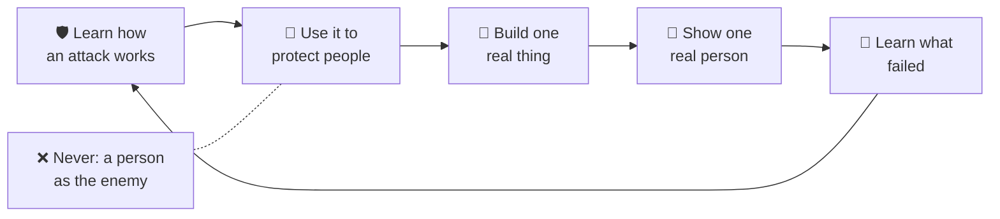

<!-- i18n-source-sha: 1e5d53cde29ad3f6 -->
<div align="center">

# 🛡️ Shepherd's Academy of War · 🌱 Daniel &amp; David

**🌐 Read this in:** English · [中文](README.zh.md) · [한국어](README.ko.md) · [日本語](README.ja.md) · [Español](README.es.md) · [Deutsch](README.de.md) · [Français](README.fr.md) &nbsp;<sub>(English is the source of truth; the rest are AI-assisted and may lag)</sub>

### 学习攻击是如何发生的，这样你才能成为守护者。一起成为睿智、有创造力、具备AI素养的建设者。

**一个由父亲和两个儿子在车上发起的家庭学院。勇气、技能和Builder Loop（建设者循环），让大人和孩子（约5–15岁）并肩成长。**

<a href="https://daniel-and-david.vercel.app/">
  
</a>

**[▶️ 试玩 Shepherd's World Model（牧羊人世界模型） →](https://agentic-portfolio-lovat.vercel.app/play/shepherd.html)** ·
**[Builder Loop 应用 →](https://daniel-and-david.vercel.app/app.html)** ·
**[阅读 SAW（Shepherd's Academy of War，牧羊人战争学院）系列 →](https://agentic-portfolio-lovat.vercel.app/articles/saw-academy-of-war-learn-the-attack.html)** ·
**[申请加入 →](https://daniel-and-david.vercel.app/#apply)**

<a href="https://daniel-and-david.vercel.app/">
  
</a>

</div>

> **真实进展（2026-10-16）。** Shepherd's Academy of War（SAW，牧羊人战争学院）仅成立数周。**尚无确认的导师**，且**一切尚未有任何实际测量数据**。其公开名称仍在试用期（见[信号](#-the-signal-is-this-working)）。目前已上线的有：Builder Loop 应用、三个小型家庭应用，以及一个基于游戏的训练——Shepherd's World Model（牧羊人世界模型）。

---

## 📰 最新动态

- **2026-10-16 · 首个可玩的训练：Shepherd's World Model（牧羊人世界模型）。** 一个牧羊人学习狼的秘密习性，以守护两群羊。这是AI领域中最小的真实*世界模型*（斯坦福 CS229 §19.3），7岁孩子也能玩。15分钟剧本（中英文）：[`docs/saw/drills/shepherd-world-model.md`](docs/saw/drills/shepherd-world-model.md)。成人版随笔：[世界模型从CS229的六行代码开始](https://agentic-portfolio-lovat.vercel.app/articles/world-models-start-in-cs229.html)。
- **2026-10-16 · 四个年龄的数字。** 一个数学思想（“数字不是它的名字”），分别为7、11、15和20岁年龄段诚实撰写，陈世峰共同作者。7岁篇为亲子剧本：[什么是数字？](https://agentic-portfolio-lovat.vercel.app/articles/number-is-not-its-name.html)
- **2026-10-12 · SAW系列发表，尚未有任何产品。** 五篇文章公开测试理念及名称（见[计划与记分板](docs/saw/SERIES.md)）。
- **更早 · Builder Loop 应用、应用库和创始家庭批次**已上线。详见[CHANGELOG.md](CHANGELOG.md)。

---

## 🧒 运作方式 —— 10岁孩子也能看懂（还能自己画）



**用文字说：**
1. 学习某种攻击是如何发生的：比如狼的习性、骗局、霸凌的手法、失败的计划。
2. 用这些知识去保护他人。
3. 做一件小而真实的事。
4. 向一个真实的人展示。
5. 从失败中学习，然后再循环一遍。

唯一不可动摇的规则：**永远不把人当作敌人。** 我们对抗的是攻击本身，而不是人。

---

## 它是什么 —— 一所学院的三扇门

| 门 | 里面发生什么 | 它在哪里 |
|---|---|---|
| **1 · 学院（SAW）** | 面向孩子的勇气与技能：学习攻击如何发生，从而成为守护者。五条关于技能使用方向的法则。嘉宾导师规则：**内容而非接触**，确保没有孩子单独与成人相处。记分卡可以记录失败。 | [五篇系列文章](https://agentic-portfolio-lovat.vercel.app/articles/saw-academy-of-war-learn-the-attack.html) · [`docs/saw/`](docs/saw/) · [研究](docs/research/shepherd-warrior-formation.md) |
| **2 · 实验田（Daniel & David）** | **[Builder Loop（建设者循环）](docs/builder-loop/)**：一个为期四周的家庭实验，包含五次快速的“构建-展示-学习”循环。AI是队友，你是大脑和良知。项目、课程、原则。 | [`docs/builder-loop/`](docs/builder-loop/) · [`docs/curriculum/`](docs/curriculum/) · [`ventures/`](ventures/) |
| **3 · 训练与演示** | 家庭可在15–20分钟内完成的活动：每周**车上训练**（SAW第5部分）和**Shepherd's World Model**游戏。还有小型应用（对话火花、过渡计时器、作业分块器、升一维（Up a Dimension）五个动手小实验）。 | [`docs/saw/drills/`](docs/saw/drills/) · [应用库](https://daniel-and-david.vercel.app/apps.html) |

---

## ⚡ 快速开始

**👪 家庭用户（无需编程，无需安装）：**
1. [试玩 Shepherd's World Model（牧羊人世界模型）](https://agentic-portfolio-lovat.vercel.app/play/shepherd.html)，配合[15分钟剧本](docs/saw/drills/shepherd-world-model.md)。
2. 打开免费的 [Builder Loop 应用](https://daniel-and-david.vercel.app/app.html)。无需注册，可安装到主屏，所有数据仅保存在本地设备。
3. 开始前请阅读[安全规则](docs/safety/)。

**🛠️ 开发者与贡献者：**
```bash
git clone https://github.com/wjlgatech/daniel-and-david.git && cd daniel-and-david
./scripts/setup.sh        # 使脚本可运行，并执行所有防护检查
./scripts/check.sh        # 提交前终检（与CI一致的防护检查）
./scripts/saw-signal.sh   # SAW是否有效？打印四个数字及补充项
```

---

## 🧭 你可以在这里做什么

| 你的目标 | 跳转入口 |
|---|---|
| 今晚做一次15分钟的家庭训练 | [Shepherd's World Model 剧本](docs/saw/drills/shepherd-world-model.md)（中英文）→ [游戏](https://agentic-portfolio-lovat.vercel.app/play/shepherd.html) |
| 做每周车上训练 | [SAW第5部分：一次训练、四个数字、六个警戒线](https://agentic-portfolio-lovat.vercel.app/articles/saw-scorecard-drill-numbers-tripwires.html) |
| 开启为期四周的家庭项目 | [Builder Loop（建设者循环）](docs/builder-loop/) → [应用](https://daniel-and-david.vercel.app/app.html) · [可打印版](docs/builder-loop/printable.md) |
| 查看SAW是否有效 | `./scripts/saw-signal.sh` · 记分账 [`docs/saw/signal.json`](docs/saw/signal.json) |
| 理解为何“战争”一词暂时保留 | [SAW第1部分](https://agentic-portfolio-lovat.vercel.app/articles/saw-academy-of-war-learn-the-attack.html) |
| 安全邀请嘉宾专家 | [SAW第4部分：内容而非接触](https://agentic-portfolio-lovat.vercel.app/articles/saw-guest-instructors-content-not-contact.html) |
| 以创始家庭身份加入 | [Founding Families（创始家庭）](docs/founding-families.md)（⛏️ 创世 · 8个名额） |
| 贡献代码或内容 | [CONTRIBUTING.md](CONTRIBUTING.md) · [AGENTS.md](AGENTS.md) |

---

## 📚 文章与写作

长文发布在作者的[agentic portfolio（主动性作品集）](https://agentic-portfolio-lovat.vercel.app/#writing)。每篇均有五种语言（English, 中文, Español, 한국어, 日本語）。

| 文章 | 适合对象 | 链接 |
|---|---|---|
| SAW 1 · 儿童战争学院：学习攻击，成为守护者 | 家长、领导者 | [阅读](https://agentic-portfolio-lovat.vercel.app/articles/saw-academy-of-war-learn-the-attack.html) |
| SAW 2 · 启示录19章只有一位战士，长久的战争有五个战场 | 家长 | [阅读](https://agentic-portfolio-lovat.vercel.app/articles/saw-revelation-19-one-fighter.html) |
| SAW 3 · 儿童勇气训练：证据支持什么，哪些方法适得其反 | 家长 | [阅读](https://agentic-portfolio-lovat.vercel.app/articles/saw-courage-training-evidence.html) |
| SAW 4 · 儿童嘉宾导师：内容而非接触 | 家长、嘉宾 | [阅读](https://agentic-portfolio-lovat.vercel.app/articles/saw-guest-instructors-content-not-contact.html) |
| SAW 5 · 家庭学院记分卡：一次车上训练、四个数字、六个警戒线 | 家长、领导者 | [阅读](https://agentic-portfolio-lovat.vercel.app/articles/saw-scorecard-drill-numbers-tripwires.html) |
| 世界模型从CS229的六行代码开始（及Shepherd's World Model） | 工程师；训练适合7–11岁 | [阅读](https://agentic-portfolio-lovat.vercel.app/articles/world-models-start-in-cs229.html) · [试玩](https://agentic-portfolio-lovat.vercel.app/play/shepherd.html) |
| 什么是数字？（四个年龄的数字，7岁） | 孩子+大人 | [阅读](https://agentic-portfolio-lovat.vercel.app/articles/number-is-not-its-name.html) |
| 数制（11岁）· 位值（15岁）· 数与表示（20岁） | 11、15、20岁 | [11](https://agentic-portfolio-lovat.vercel.app/articles/number-systems-from-tally-to-place-value.html) · [15](https://agentic-portfolio-lovat.vercel.app/articles/place-value-ten-symbols-every-number.html) · [20](https://agentic-portfolio-lovat.vercel.app/articles/number-vs-representation-for-programmers.html) · [试玩](https://agentic-portfolio-lovat.vercel.app/play/numbers.html) |

---

## 🎯 已锁定的决策（及其原因）

- **永远不把人当作敌人。** 技能只针对攻击本身，绝不针对人。任何针对人的暴力言论都不被允许。
- **内容而非接触。** 嘉宾专家通过录制或有监督的内容授课，确保没有孩子单独与成人相处。安全规则见：[`docs/safety/`](docs/safety/)。
- **未测不宣。** 只要记分账未显示数据，系列就会声明“尚未有测量”；`faculty_confirmed`为0时，不宣称有导师。
- **先有信号，再有建设。** 只有四项数据通过（见[信号](#-the-signal-is-this-working)），SAW才正式建设。Shepherd's World Model 只是作品集演示，非SAW正式产品。
- **衡量能力，而非金钱。** 我们衡量孩子在未被推动下能做什么（见[变革理论](docs/vision/theory-of-change.md)），见下方能力阶梯。

---

## 📏 信号：它是否有效？

SAW系列的目标是促成决策，而非博得掌声。到**2026-11-11**，[`signal.json`](docs/saw/signal.json)必须记录以下数据。`./scripts/saw-signal.sh`会打印这些数字，并在截止日后如有缺失则退出1。

| 指标 | 通过标准 | 决定什么 |
|---|---|---|
| `strangers_asked`, `strangers_heard_militant` | 询问20+人，少于一半认为“激进” | 是否保留公开名称（包括本仓库名） |
| `reader_mission_numbers` | 10+位读者发布任务结果 | 是否有外部用户参与 |
| `outside_reviewers_of_guest_rules` | 1+位儿童保护专家评审第4部分 | 是否可邀请首位嘉宾 |
| `family_drills_run` | 4+次家庭每周车上训练，孩子亲自填写卡片 | 训练是否适合七岁孩子 |
| *补充项:* `shepherd_demo_drills` | 计数，不做门槛 | 有多少家庭试玩了Shepherd's World Model（不计入前四项） |

**当前：** 四项中0项达标。对于第三周来说这是诚实的，如果到2026-11-11仍如此，将会公开说明。

---

## 🏷️ 关于名称（及本仓库名）

本仓库仍名为`daniel-and-david`，这是有意为之。SAW自身规则要求其公开名称在**2026-11-11**前处于试用期：如果20位陌生人中少于一半认为“激进”，则名称保留。提前更名会让测试失去意义。

如果名称通过，只需一条命令即可更名：
```bash
gh repo rename shepherds-academy-of-war --repo wjlgatech/daniel-and-david
```
GitHub会自动重定向旧仓库URL和git远程，daniel-and-david.vercel.app在线站点不受影响。**唯一受影响的是：** GitHub Pages地址（`wjlgatech.github.io/daniel-and-david/`）会变动。因此更名时需同步更新本README和`apps/web`中的所有Pages链接。

如果名称未通过，SAW将作为家庭内部名称，本仓库继续使用实验田名称。

---

## 我们真正攀登的阶梯

我们衡量的是**能力**，而非金钱。公开阶梯是任何人——无论孩子还是大人——都能*做到*的事：

<p align="center"></p>

*游戏的意义在于你在攀登过程中成为怎样的人。* 还有一条进阶创业阶梯，故意放在后面。详见[两条阶梯](docs/vision/milestones.md)。

---

## 建设者是如何炼成的

不是靠听讲座。而是**亲手做一件真实的事，从头到尾，弄懂每个环节为何成败。**

<p align="center"></p>

- **项目。** [`ventures/kc-matchday-basecamp/`](ventures/kc-matchday-basecamp/) 是一个为堪萨斯城足球夏季设计的合法、场馆合作的球迷工具与本地商业概念。**需求文档✅已完成；Web应用🟡尚未启动开发。**
- **课程。** 一种方法，适合各年龄段：
  - [Daniel，11岁](docs/curriculum/daniel-age-11/)：构建、定价、销售、测量，并带领[AI Build Kit](docs/curriculum/daniel-age-11/build-kit.md)；
  - [David，6岁](docs/curriculum/david-age-6/)：数数、画标志、迎接顾客；
  - [批判性思维](docs/curriculum/critical-thinking/)：5W1H表格，也[集成在AI队友中](.claude/README.md)。
- **原则：**
  - [AI原生公司](docs/principles/ai-native-company.md)
  - [Agentic Engineering（主动性工程）](docs/principles/agentic-engineering.md)
  - [Pain2Gain（痛点转化）](docs/principles/pain2gain.md)
  - [价值观](docs/principles/values.md)

<p align="center"></p>

### 设计中，尚未发布

- 🗣️ **Builder Loop Coach（建设者循环教练）。** 语音优先教练，通过对话引导同样的循环。数据仅存本地，始终明确是AI。见[`apps/web-agent/`](apps/web-agent/)。
- 🌿 **以赛亚35复兴路径**，面向处于荒凉阶段的成年人。用四个原则（复兴、救赎、再生、复活）结合同一循环。信仰为根基，欢迎所有人。见[复兴路径](docs/vision/isaiah-35-restoration.md)及[4周复兴循环](docs/curriculum/adult-restoration/)。
- 🌍 **学习枢纽。** 一个活跃的学习、工具和协作枢纽，向家长、孩子、工程师、创业者和AI智能体开放。见[枢纽指南](docs/community/hub.md)。

---

## 🗺️ 仓库结构

```
daniel-and-david/                 （Shepherd's Academy of War 的主仓库；名称决议日为2026-11-11）
├── docs/
│   ├── saw/             🛡️ SAW：系列计划、信号记分账、训练/（Shepherd's World Model剧本，中英文）
│   ├── builder-loop/    ⭐ 4周家庭Builder Loop，实验田的原子单元
│   ├── founding-families.md  🧱 创世：创始家庭申请
│   ├── vision/          使命、变革理论与北极星、两条阶梯、复兴路径
│   ├── safety/          儿童安全、隐私、同意、内容审核、AI使用边界
│   ├── research/        引用研究，包括SAW背后的牧羊人-战士档案
│   ├── principles/      工作方式：AI原生、主动性工程、价值观
│   ├── curriculum/      Daniel（11岁）、David（6岁）、批判性思维、成人复兴
│   ├── marketing/       长篇故事与可直接发布的LinkedIn内容
│   ├── community/       枢纽指南
│   └── assets/          本README用到的信息图（SVG）
├── apps/web/            在线网站（daniel-and-david.vercel.app）：首页、Builder Loop应用、演示
├── apps/web-agent/      🟡 Builder Loop Coach（设计中）
├── ventures/            项目1：kc-matchday-basecamp
├── agents/hello-agent/  极简入门智能体
├── scripts/             setup.sh · check.sh（防护检查）· saw-signal.sh（SAW判定）
├── .claude/             智能体工具包：技能、工作流、钩子
└── .github/             CI、模板、贡献者入门
```

---

## 🛠️ 开发

```bash
./scripts/check.sh   # 全部防护检查：链接 · 工具包 · 状态真实性 · 注册安全 · Web应用（与CI一致）
```

绿色表示所有链接可用、文档中所有状态声明真实、注册表单安全、Web应用可用。智能体开发：请先阅读[AGENTS.md](AGENTS.md)和[.claude/README.md](.claude/README.md)。近期目标不是贡献量，而是**十个家庭完成一次真实Builder Loop**，以及SAW的四项数据在截止日达标。

> 🧱 **创始家庭**可提前私享工作室自有AI工具（AnyAgent、Super U、DreamMakeTrue）。详见[创始家庭](docs/founding-families.md)。

---

## 📖 文档

| 文档 | 内容简介 |
|---|---|
| [`docs/saw/SERIES.md`](docs/saw/SERIES.md) | SAW计划、10X目标（可失败）、仅创始人能做的决策 |
| [`docs/saw/drills/shepherd-world-model.md`](docs/saw/drills/shepherd-world-model.md) | 15分钟Shepherd's World Model训练剧本（中英文） |
| [`docs/research/shepherd-warrior-formation.md`](docs/research/shepherd-warrior-formation.md) | SAW背后的研究档案 |
| [`docs/builder-loop/`](docs/builder-loop/) | Builder Loop指南、可打印版与迭代日志 |
| [`docs/safety/`](docs/safety/) | 儿童安全、隐私与同意规则（所有活动前必读） |
| [`docs/vision/theory-of-change.md`](docs/vision/theory-of-change.md) | 因果模型与唯一追踪指标 |
| [`docs/founding-families.md`](docs/founding-families.md) | 创始家庭批次与减半计划 |
| [`docs/marketing/the-daniel-and-david-story.md`](docs/marketing/the-daniel-and-david-story.md) | 故事版本：10岁能懂，怀疑者能查证 |

---

## 我们坚守的标准

<p align="center"></p>

- **始终合法且诚实。** 我们靠值得信赖取胜，而不是投机取巧。
- **小步快跑，务实交付。** 一个可用的作品胜过完美的计划。
- **边做边教。** 如果6岁孩子听不懂“为什么”，我们就解释得更好。
- **成长中慷慨。** 慷慨内嵌于模式，而非事后补充。

---

## License

[MIT](LICENSE)。开放构建，欢迎学习与再开发。

<p align="center"><i>学习攻击，成为守护者。做点好事，用它去祝福他人。——献给Daniel &amp; David</i></p>
